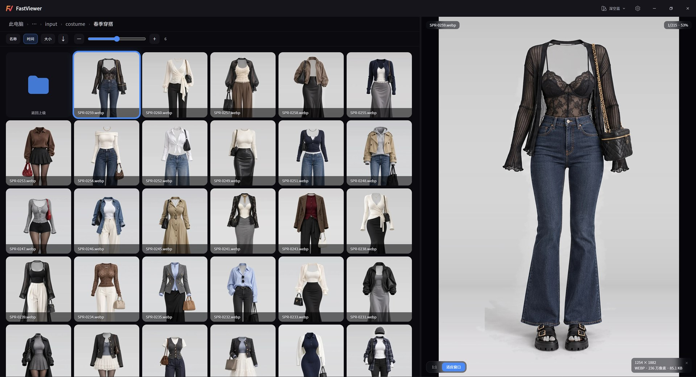

  

<h1 align="center">FastViewer</h1>

Windows 上的本地图片 / 视频浏览器：像资源管理器一样翻文件夹，看图看视频更快、更好看。

---

## 界面预览

左侧图墙与右侧查看器同屏显示，顶部为面包屑与排序 / 列数控制，当前图片带强调色描边。

## 下载与安装

前往 [Releases](https://github.com/bsawang/FastViewer/releases/latest) 下载：

| 文件 | 说明 |
| --- | --- |
| `FastViewer-x.x.x.exe` | 安装包（推荐）。双击安装，不需要管理员权限，安装到当前用户目录，并注册文件关联与文件类型图标。 |
| `FastViewer-x.x.x.zip` | 免安装版。解压后直接运行 `FastViewer.exe`，不写注册表；文件关联请使用安装版。 |

系统要求：Windows 10 / 11（64 位）。

## 快速上手

1. 启动后自动回到上次浏览的文件夹，首次使用进入「此电脑」。
2. 左侧图墙中点击文件夹进入；顶部面包屑可逐级返回，也可点「返回上级」。
3. 点击任意图片或视频，右侧查看器即刻显示；滚轮或方向键继续翻看。
4. 想调整布局？拖动中间的竖线即可改变图墙与查看器的宽度比例。

## 主要功能

### 浏览

- 图墙按文件夹展示，列数可在 2–10 之间调整，卡片大小自适应。
- 支持按名称 / 修改时间 / 大小排序，并可正序或倒序。
- 「此电脑」中列出磁盘与系统快速访问目录（桌面、下载、文档、图片、音乐、视频），以及你在资源管理器中固定的文件夹。
- 长列表滚动流畅，右下角有「回到顶部」浮动按钮。

### 看图

- 双击图片进入全屏查看，`Esc` 退出；全屏内可自由缩放、左右切换、呼出详情。
- 缩放支持 `Ctrl + 滚轮`、`+` / `-`、适应窗口（`0`）与原始大小（`1`）。
- 图片详情面板展示尺寸、文件大小、修改时间、EXIF（相机、光圈、快门、ISO、拍摄时间等）。

### 看视频

- 内置播放控制条：播放 / 暂停、进度、音量、静音与重播。
- 切换视频时自动保持静音状态。
- 详情面板显示分辨率、帧率、帧数、时长、编码与流信息。

### 文件管理

- `Ctrl` 点击可多选，选中项带强调色描边。
- 右键菜单支持：在文件浏览器中打开、重命名、复制、剪切、粘贴、删除。
- 多选后右键可对整组执行「复制 N 项 / 剪切 N 项 / 删除 N 项」，删除会移入回收站并需要确认。
- 复制或剪切后到其他文件夹粘贴即可生成副本或移动文件，重名时自动加序号。

### 外观与记忆

- 标题栏右上角可切换皮肤，内置 4 套深色 + 1 套浅色。
- 自动记住上次目录、排序方式、列数、分屏比例、窗口位置与大小、主题。
- 标题栏齿轮打开设置：打开配置目录、恢复默认布局、清理全部偏好。

## 快捷键

| 按键 | 作用 |
| --- | --- |
| `←` / `→` | 上一张 / 下一张 |
| `Ctrl + 滚轮` | 缩放图片 |
| `+` / `-` | 放大 / 缩小 |
| `0` / `1` | 适应窗口 / 原始大小 |
| `F` | 图片全屏（仅图片，视频无全屏） |
| `Esc` | 退出全屏 |
| `I` | 显示 / 隐藏详情面板 |
| `空格` | 视频播放 / 暂停 |
| `Shift + ←` / `Shift + →` | 视频快退 / 快进 |
| `↑` / `↓` | 视频音量加 / 减 |
| `M` | 视频静音开关 |

## 支持的文件类型

- **图片**：JPG / JPEG / JFIF、PNG / APNG、GIF、WebP、AVIF、BMP、ICO、SVG
- **视频**：MP4、M4V、WebM、OGV / OGG、MOV、MKV

视频能否播放取决于系统解码器。若某些格式黑屏或报错，可尝试安装对应解码组件后重启应用。

## 文件关联

打开标题栏齿轮 →「文件关联」，按图片 / 视频分组勾选需要的扩展名即可登记（可随时取消）。

> 受 Windows 限制，程序无法直接把自身设为「默认应用」。在 Windows 10 上首次双击图片时可能仍会弹出「打开方式」，手动选择一次 FastViewer 后即生效；也可在面板中点击「系统默认应用」前往系统设置调整。

## 数据与卸载

- 配置保存在 `%APPDATA%\fastviewer\fastviewer-config.json`，记录目录、排序、列数、分屏比例、窗口位置、主题等。
- 删除文件一律移入回收站，不做永久删除。
- 卸载：Windows「设置 → 应用 → 已安装的应用」中卸载 FastViewer，卸载时会清理已注册的文件关联；配置目录会保留，可在应用内「清理全部偏好」重置。

## 常见问题

**双击图片没有直接用 FastViewer 打开？** 见上文「文件关联」，需要先登记扩展名并在 Windows 中确认一次默认程序。

**某些视频黑屏或提示无法播放？** 多为系统缺少对应解码器（如 HEVC），安装解码组件后重试。

**缩略图第一次加载略慢？** 首次进入目录需要读取并生成缩略图，之后会更快。

## 反馈

使用中遇到问题或有建议，欢迎在 [Issues](https://github.com/bsawang/FastViewer/issues) 中反馈。
