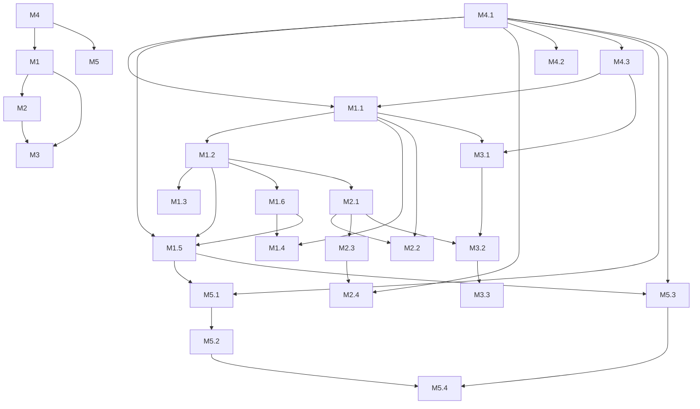

# FastViewer 技术规格 (v0.1)

> 业务层 → [prd.md](./prd.md)（本文件的 Mx 模块与 prd §2 一一对应）

## 0. 元信息

- 状态：已确认
- 日期：2026-11-06
- 决策人：用户（项目属主）

## 1. 项目定位

自用桌面图片浏览器：Electron 双层壳（壳页 = 标题栏与窗口控制，内容区 = `<webview>` 载本地文件服务页面），打开任意本地文件夹，以图墙浏览图片与视频。

核心定位：**文件夹浏览优先、界面自绘好看、不做格式扩展、不做编辑**。业务非目标见 [prd.md §3](./prd.md#3-非目标)；技术非目标见本文件 §5。

## 2. 核心口径

跨子需求共享的定义。详细设计只引用本节，不再重复。

### 2.1 路径与文件规则

- 只接受**盘符绝对路径**（正则 `^[A-Za-z]:[\\/]`），入参经 `path.resolve` 归一化（统一反斜杠）。
- 虚拟根“此电脑”在内容页状态中以空串 `''` 表示；它不是文件系统路径，只作为面包屑/返回上级的跳转目标，**不作为** `/api/dir` 的 `path` 入参。
- 拒绝：UNC（`\\server\share`）、设备路径（`\\?\`、`\\.\`）、含 `\0` 的串、空串。拒绝时返回 `FORBIDDEN_PATH`。
- 隐藏项不进入列表：名称以 `.` 开头、或名称（不区分大小写）为 `desktop.ini` / `thumbs.db`。
- 排序：**目录永远排在文件之前**；组内按所选键；名称使用 `Intl.Collator('zh-CN', { numeric: true, sensitivity: 'base' })`；同值以名称升序兜底，保证分页稳定。
- 显示格式：文件大小 `1.2 MB`（1024 进制、1 位小数，<1 KB 显示 `512 B`）；时间 `2026-11-06 14:03`。

### 2.2 媒体分类（按扩展名，小写）

| kind | 扩展名 | 行为 |
|---|---|---|
| `image` | jpg jpeg jfif png apng gif webp avif bmp ico svg | 上图墙，点击进查看器 |
| `video` | mp4 m4v webm ogv ogg mov mkv | 上图墙，点击进查看器播放 |
| `dir` | — | 上图墙（文件夹图块） |
| `other` | 其余全部 | **不上图墙** |

分类只决定“是否展示、怎么打开”；能否解码由 Chromium 152 决定，解码失败走错误态（M2.2 / M3.3）。TIFF / HEIC / JP2 / QOI / PSD 等因此天然不出现（prd 非目标）。

### 2.3 图块度量

- 列数 `C`，范围 **2–10**，默认 **4**，Ctrl+滚轮步进 **1**；图块宽度 `S` 由列数与容器宽度自适应：`S = max(56, floor((W - 2×16 - 8×(C-1)) / C))`，卡片总高恒为 `S`，缩略图区域为 `S × S` 正方形，文件名以浮层压在图内底部。
- 间距 `gap = 8`，容器内边距 `padding = 16`。
- 窄窗口保护：实际列数 `cols = min(C, max(1, floor((W - 32 + 8) / (56 + 8))))`，保证图块不小于 56 px。
- 文件名**不限行数、完整换行**：浮层宽 `S`（左右内边距各 10 px），字号 10 px、行高 14 px、上下内边距各 6 px；`word-break: break-all` + `text-wrap: balance` 避免出现末行单字符（孤字），高度随行数向上生长，超出卡片顶部的部分被裁切，**不改变卡片尺寸**。
- 行高固定 `rowH = S + gap`，`rowTops[r] = 16 + r × rowH`，`totalH = 2×16 + rows × rowH`；可见区间与锚点按 `rowTops` 二分查找。
- 缩略图 `object-fit: cover; object-position: center top`：铺满正方形区域、顶部居中，过高的图裁掉底部、过宽的图裁掉左右。文件名浮层绝对定位贴卡片底部（`left/right/bottom: 0`），背景 `rgba(0,0,0,.55)`，完整换行不省略；文件夹/盘符在正方形内居中显示图标，名称同样以浮层底部换行。
- 排序键（名称/时间/大小 + 正倒序）与列数控件（`−` / 滑杆 / `+` / 数值）位于**面包屑下方**的控件行；图墙底部不再有工具条。
- 卡片 hover 轻微放大 `scale(1.025)` 并抬升 `z-index`，按下回缩 `scale(0.99)`；过渡时长 `--t-hover`。
- 当前查看项 `.is-current` 用 **5 px** 强调色描边 + 外发光标识；查看器切换后若当前图块不在可见范围，图墙滚动到 `rowTops[row] - 16`，使该行贴顶；已在可见范围内则不滚动。

### 2.4 缩放口径

- `scale ∈ [0.05, 16]`。
- 适应窗口：`fit = min(1, vw/iw, vh/ih)`（小图不放大）。
- 缩放滚轮：`Ctrl+滚轮`，系数 `factor = 1.1^(-deltaY/100)`，以光标为锚点；普通滚轮用于切换上一项/下一项。
- 双击：适应窗口 ↔ 1:1，以点击点为锚。
- 平移仅在 `scale > fit` 时启用。

### 2.5 本地服务与鉴权

- 绑定 `127.0.0.1:0`（系统分配端口），base URL `http://127.0.0.1:<port>/`。
- 每次启动生成 32 字节随机 token（hex）。首次导航 `GET /?t=<token>` 校验通过后回 `Set-Cookie: fv=<token>; Path=/; HttpOnly; SameSite=Strict`；此后所有同源请求凭 cookie。
- 每个请求校验：`Host === 127.0.0.1:<port>`；cookie 或 `?t=` 合法。失败一律 `403 UNAUTHORIZED`。
- **不发送任何 CORS 头**。带 `Origin` 且不等于自身 base URL 的请求 → `403`。
- 静态资源只从构建产物 `dist/web/` 读取，按 URL 路径映射，禁止 `..` 越界。

### 2.6 配置结构与默认值

文件：`<userData>/fastviewer-config.json`（Windows 下 `%APPDATA%\FastViewer\fastviewer-config.json`）。

```json
{
  "version": 1,
  "lastFolder": null,
  "sort": { "key": "name", "order": "asc" },
  "gridColumns": 4,
  "detailOpen": true,
  "splitRatio": 0.45,
  "theme": "midnight",
  "window": null
}
```

| 字段 | 类型/取值 | 默认 | 校验 |
|---|---|---|---|
| version | `1` | 1 | 不等 → 视为坏配置，整体回默认 |
| lastFolder | 绝对路径 / null | null | 非法路径 → null |
| sort.key | `name` \| `mtime` \| `size` | `name` | 非法 → name |
| sort.order | `asc` \| `desc` | `asc` | 非法 → asc |
| gridColumns | 2–10 整数 | 4 | 越界 → 钳制 |
| detailOpen | boolean | true | 非布尔 → true |
| splitRatio | 0.2–0.8 小数 | 0.45 | 越界 → 钳制 |
| theme | `midnight` \| `obsidian` \| `moss` \| `ember` \| `dawn` | `midnight` | 非法 → midnight |
| window | `{x,y,width,height,maximized}` / null | null | 非法或不可见 → null |

`splitRatio` = **图墙宽度占内容区宽度的比例**（分隔条左侧）；查看器常驻，比例始终生效。

### 2.7 键盘映射

| 上下文 | 按键 | 动作 |
|---|---|---|
| 图墙 | Ctrl+滚轮 | 列数 ±1（向上减少列数、图块变大） |
| 查看器（图片/视频） | ← / → | 上一项 / 下一项（循环） |
| 查看器 | Esc | 全屏浮层打开→关闭浮层；否则无动作（查看器常驻，不关闭） |
| 查看器 / 全屏浮层 | 滚轮 | 上一项 / 下一项（循环；累积 `|deltaY| ≥ 50` 触发，同一手势 200 ms 冷却） |
| 查看器 / 全屏浮层（图片） | Ctrl+滚轮 | 缩放（光标锚点，1.1 倍/格） |
| 查看器（图片） | 双击 | 适应窗口 ↔ 1:1 |
| 查看器 | `+` / `-` | 放大 / 缩小 1.1 倍（中心锚点） |
| 查看器 | `0` / `1` | 适应窗口 / 原始尺寸 |
| 查看器 | `I` | 详情浮窗开关（全屏浮层内为底部详情区） |
| 查看器（图片） | `F` | 应用内全屏浮层开关；视频不进入浮层 |
| 视频 | Space | 播放 / 暂停 |
| 视频 | Shift+← / Shift+→ | 后退 / 前进 5 秒 |
| 视频 | ↑ / ↓ | 音量 ±5% |
| 视频 | `M` | 静音开关 |

### 2.8 HTTP 错误码

错误响应体统一为 `{"error":{"code":"...","message":"..."}}`，`message` 为中文，可直接展示。

| code | HTTP | 触发 |
|---|---|---|
| `UNAUTHORIZED` | 403 | token/cookie 缺失或错误、Host/Origin 非法 |
| `BAD_PATH` | 400 | 非绝对盘符路径、非目录 |
| `FORBIDDEN_PATH` | 403 | UNC / 设备路径 / 含 NUL |
| `NOT_FOUND` | 404 | 路径不存在 |
| `IO_ERROR` | 500 | 读目录/读文件失败 |
| `RANGE_INVALID` | 416 | Range 越界或多区间（v1 不支持） |
| `BAD_REQUEST` | 400 | 参数非法（limit/offset/sort） |

## 3. 架构概览

### 3.1 技术底座（版本写死）

| 项 | 版本 | 说明 |
|---|---|---|
| Electron | **44.0.0** | 内置 Chromium **152.0.7977.54**、Node **24.18.1**（本机实测） |
| TypeScript | **7.0.2** | strict；只做类型检查，产物由 esbuild 生成 |
| esbuild | **0.28.2** | main/preload 打 `platform:node, format:cjs, target:node20, external:['electron']`；shell/web 打 `platform:browser, format:iife` |
| electron-builder | **26.15.3** | Windows `zip`；`asar:false` |
| vitest | **5.0.3** | 纯逻辑与服务端测试 |
| tsx | **4.23.15** | 串构建脚本 |
| @types/node | **26.6.5** | 构建期 Node 24.15.0（本机实测） |
| HTTP 服务 | Node 内置 `http` | 不引入 Express/Koa |

前端：原生 TypeScript + CSS，无框架（理由见 §3.6）。

### 3.2 目录与模块边界

```
src/
  main/        # 主进程：窗口、本地服务、目录索引、配置、IPC
    index.ts       # 应用入口（单实例锁、whenReady、启动顺序）
    window.ts      # BrowserWindow 创建 / 窗口状态 / 全屏
    server.ts      # http 服务：鉴权、静态资源、/api/dir、/api/file（Range）
    dir-index.ts   # 目录索引、分类、排序、分页、缓存
    range.ts       # Range 解析（纯函数）
    path-guard.ts  # 路径校验（纯函数）
    media-types.ts # 扩展名分类（纯函数）
    config.ts      # 配置读写、校验、原子写
    logger.ts      # 控制台 + userData/logs/main.log
  preload/
    shell.ts       # 壳页桥：window.fvShell
    guest.ts       # 内容页桥：window.fvHost
  shell/         # 壳页（标题栏 + webview 容器 + 设置/关于浮层）
  web/           # 内容页（图墙 / 查看器 / 视频 / 全屏）
  shared/        # 纯类型与纯函数（无 Node / Electron / DOM 依赖）
tests/           # vitest：tests/*.test.ts + fixtures/
scripts/         # build.ts / start.ts / bench-dir.ts / mkfixture.mjs
build/           # 打包资源：icon.ico（7 尺寸）/ icon.png（1024 母图）/ installer.nsh
docs/            # prd / spec / PROGRESS
```

边界（硬约束）：

1. `main/**` 可用 Node/Electron，**不得 import `web/**` 或 `shell/**`**；共享内容只从 `shared/**` 取。
2. `preload/**` 只做桥接（`contextBridge` / `ipcRenderer`），不含业务逻辑。
3. `shell/**` 只能用 `window.fvShell`，不得直接访问文件系统。
4. `web/**` 只能用 HTTP API + `window.fvHost`，**不得 import Electron/Node**。
5. `shared/**` 必须能被三端同时引用：不得 import Node/Electron，不得在模块顶层访问 DOM。

### 3.3 存储与通信

**存储**：仅一个 JSON 配置文件（§2.6）。无数据库、无缩略图磁盘缓存。

**HTTP API**（内容页 → 主进程）：

| 方法 | 路径 | 入参 | 出参 |
|---|---|---|---|
| GET | `/` | `?t=<token>` | 内容页 HTML（首次导航，写 cookie） |
| GET | `/assets/*` | — | 静态资源（css/js/字体/图标） |
| GET | `/api/dir` | `path, sort, order, offset, limit` | §M1.1 的目录页 |
| GET | `/api/drives` | — | §M1.6 的盘符列表（固定盘 + 可移动盘） |
| GET/HEAD | `/api/file` | `path` + 可选 `Range` | 文件流（200/206/416） |

**IPC 桥（壳页）** `window.fvShell`：

| 成员 | 签名 | 说明 |
|---|---|---|
| bootInfo | `() => Promise<{appUrl, guestPreloadUrl}>` | 壳页拿到内容页 URL（含 token）与 guest preload 的 file:// 绝对路径 |
| window | `(action: 'minimize'\|'toggle-maximize'\|'close') => void` | 窗口控制 |
| onWindowState | `(cb: (s: {maximized, fullscreen}) => void) => void` | 窗口状态变化（标题栏只显示应用名，不再显示文件夹名） |
| onImmersive | `(cb: (on: boolean) => void) => void` | 内容页全屏浮层开/关 → 壳页隐藏/恢复标题栏与 webview 区域（窗口本身不变） |
| about | `() => Promise<{app, electron, chromium, configPath}>` | 设置/关于 |
| revealConfig | `() => void` | 打开配置目录 |
| resetLayout | `() => Promise<void>` | 恢复默认布局 |
| resetPrefs | `() => Promise<void>` | 清理全部偏好 |

**IPC 桥（内容页）** `window.fvHost`：

| 成员 | 签名 | 说明 |
|---|---|---|
| getStartupPath | `() => Promise<string \| null>` | 命令行启动携带的目录或文件路径（优先于 lastFolder） |
| onOpenPath | `(cb: (path: string) => void) => void` | 主进程转发第二实例/启动参数的目录或文件路径 |
| getPathForFile | `(file: File) => string` | 拖放文件的真实路径（`webUtils.getPathForFile`） |
| setImmersive | `(on: boolean) => void` | 请求壳页进入/退出沉浸态（只隐藏标题栏并扩展 webview，不调用系统全屏） |
| getConfig | `() => Promise<Config>` | §2.6 |
| patchConfig | `(patch: Partial<Config>) => Promise<Config>` | 合并写（尺寸变化防抖 150 ms） |
| setFolderTitle | `(name: string) => void` | 更新系统窗口标题（任务栏/Alt-Tab）；壳页标题栏不显示目录名 |

### 3.4 部署与运行

- 脚本：
  - `npm run dev` = `tsx scripts/build.ts && node scripts/start.ts`
  - `npm run build` = `tsx scripts/build.ts`
  - `npm run typecheck` = `tsc --noEmit`
  - `npm test` = `vitest run`
  - `npm run package` = build + `electron-builder --win --publish never`（目标由 `electron-builder.yml` 的 `win.target` 决定：`zip` + `nsis`）
- `scripts/start.ts` 必须**清掉 `ELECTRON_RUN_AS_NODE`** 再拉起 electron（否则 Electron 退化成纯 Node，`app` 为 undefined —— web2app 已踩）。
- 启动顺序：单实例锁 → `app.whenReady` → 读配置 → 起本地服务（端口 0）→ 建窗口（加载壳页）→ 恢复窗口 bounds → 壳页取 bootInfo → 建 webview → 内容页启动。
- 单实例：`app.requestSingleInstanceLock()`；第二次启动 → 聚焦已有窗口，并把命令行里的目录或文件原样经主进程 `fv:open-path` 事件发给 webview guest（guest 未就绪时暂存，`did-finish-load` 后补发）；文件路径由内容页解析为“打开父目录 + 定位该文件”。
- 打包：`electron-builder.yml` 固定 `electronVersion: 44.0.0`、`asar: false`（webview preload 不认 asar 内路径）、`win.target: [zip, nsis]`、`win.icon: build/icon.ico`、`artifactName: FastViewer-${version}.${ext}`、`electronLanguages: [zh-CN, en-US]`、压缩级别由 `ELECTRON_BUILDER_COMPRESSION_LEVEL=3` 控制（web2app 实测 mx=3 与 mx=1 体积相同、远快于 mx=7）。默认从 GitHub 下载 Electron 发行包；网络不通时用 `-c.electronDist=<本地 electron-v<ver>-win32-x64.zip>` 复用 `%LOCALAPPDATA%\electron\Cache` 里的缓存。
- 应用图标：`build/icon.ico`（含 16/24/32/48/64/128/256 七尺寸）由 `docs/fvlogo.png` 直接生成——1024×1024 透明底 FV 渐变字形，原样存为 `build/icon.png` 作母图，**不加底板、不做圆角遮罩**，各尺寸由母图 LANCZOS 缩放；供 exe 资源、安装器/卸载器与 BrowserWindow 共用。`scripts/build.ts` 同时把它复制到 `dist/shell/assets/icon.ico`，`src/main/window.ts` 用它作 BrowserWindow 图标，保证开发期窗口与任务栏即显正式图标。
- 文件类型图标：`scripts/file-icons.ts` 按统一模板生成 `build/file-icons/<ext>.svg` 与 `<ext>.ico`（16/20/24/32/40/48/64/96/128/256 多尺寸）：40×40 文件页外形 + 折角高光 + 底部白色大写扩展名，位图 `#7F56D9`、矢量图 `#12B76A`、视频 `#F04438`。SVG 供设置面板芯片（复制到 `dist/shell/assets/file-icons/`），ICO 由 `win.fileAssociations` 的 `icon` 在安装时释放到 `resources\<ext>.ico`，作为各 ProgID 的 `DefaultIcon`。
- 文件关联：NSIS 安装包按 `win.fileAssociations` 为每个扩展名注册独立 ProgID（`HKCU\Software\Classes\.<ext>` → `FastViewer.<ext>`，`shell\open\command` = `"<install>\FastViewer.exe" "%1"`，`DefaultIcon` = `"<install>\resources\<ext>.ico"`）；安装器 `oneClick`、`perMachine: false`、`runAfterFinish: false`；卸载删除 ProgID 与 OpenWithProgids（`APP_UNASSOCIATE`）。electron-builder 卸载不会清扩展名默认值，`build/installer.nsh` 的 `customUnInstall` 逐扩展比对：只有当前值仍等于我们的 ProgID 才删除，避免覆盖用户后来改选的默认程序。**不写 `UserChoice`**：Windows 10 已设默认的扩展（如本机 jpg/png→照片、mp4→PotPlayer）仍由用户首次“始终使用”或在系统默认应用里确认。
- 运行期开关：`app.commandLine.appendSwitch('enable-features','OverlayScrollbar')`（细滚动条）；`app.commandLine.appendSwitch('autoplay-policy','no-user-gesture-required')`（视频查看器默认自动播放）。
- 调试：仅当环境变量 `FV_DEBUG_PORT` 存在时追加 `remote-debugging-port`；否则不暴露调试端口。

### 3.5 约定

- 文件/目录 kebab-case；纯函数与类型放 `shared/`；主进程每个职责一个文件。
- 错误：内部抛 `Error` 带 `code` 字段（§2.8），HTTP 层映射为响应；UI 只展示 `message`。
- 日志：`logger.info/warn/error`；同时写 `<userData>/logs/main.log`（1 MB 轮转，保留 2 份）；**不得记录 token**。
- 配置写入：临时文件 + `fs.renameSync` 原子替换；写合并 300ms 防抖，`before-quit` 强制 flush。
- 测试组织：`tests/<模块>.test.ts`；纯函数用表驱动；HTTP 用 `listen(0)` 起真实服务 + Node 24 内置 `fetch`；fixtures 由 `scripts/mkfixture.mjs` 生成，不入库大文件。
- 渲染层不引入任何运行时依赖（零 `dependencies`，只有 `devDependencies`）。

### 3.6 选型记录

| 选型 | 理由 | 被否决的替代方案 |
|---|---|---|
| Electron 44.0.0 双层壳 | 自绘标题栏与按钮完全可控、无任何浏览器 UI 泄漏、多屏窗口行为可用系统能力兜住；与 web2app 已验证实现同构 | ① `chrome --app`：零分发但标题栏/右键菜单/边框收不回来；② PWA + WCO：右侧 233 px 系统按钮区收不回、依赖安装链路；③ WebView2：宿主进程仍要自写，WebView2 Runtime 792 MB 且版本不可控；④ CEF：166.7 MB 额外分发、集成成本最高 |
| 壳页 + `<webview>`（而非单页渲染） | 壳（可信、能管窗口）与内容（纯 Web、无 Node）物理隔离；内容页可整页重载而不动壳；与用户拍板的路线一致 | ① 单页渲染：更少进程/更简单，但壳与内容共享 DOM 与权限边界；② `WebContentsView`：层级/布局要手算，CSS 无法直接排版 |
| 本地 HTTP 服务 + Range 206 | 视频定位实测：无 Range 时 `seekable=[0,0]`（拖不动）；统一 URL 便于缓存与 curl 验收；避开 `file://` 的编码/路径问题 | ① `file://`：路径编码与权限行为不可控；② 自定义 protocol：要自己实现 Range 与 MIME，成本高于收益 |
| 原生 TS + CSS，无框架 | 虚拟图墙与缩放引擎本来就要手写；无运行时依赖、包体最小、样式完全可控 | React / Vue：对 60 fps 虚拟滚动没有帮助，反而增加包体与依赖维护 |
| 虚拟滚动 + 分页 API | 10 万项目录不能全量进 DOM；DOM 数量与内存可控 | ① 全量 DOM：节点与解码内存不可控；② `content-visibility:auto`：仍会创建全部节点，只省绘制 |
| 系统最大化 / `isMaximized()` | 本项目保留原生窗口边框（`titleBarStyle:'hidden'`），系统 API 可靠 | web2app 的 `workArea + setBounds` 方案：那是 `frame:false + transparent` 的补丁，多屏 DPI 下会失准 |
| 单个 JSON 配置 | 字段只有 7 个；手写校验即可，零依赖 | electron-store（多一个依赖）/ SQLite（过重） |
| vitest 5 | 与 esbuild/TS 7 配合零额外配置；内置 expect 足够 | jest（ESM + TS 转译配置成本高） |
| `asar:false` + zip + NSIS | webview preload 不接受 asar 内路径；zip 保留免安装解压即用；文件关联只能由安装器写入注册表，NSIS 同时负责安装/卸载清理 | 仅 zip（无法注册系统文件关联）；运行时自写注册表（路径随解压位置漂移、需自备卸载清理） |

## 4. 功能需求

**子需求状态索引（progress 独占更新，spec 只填初始全 ⬜）：**

| 编号 | 模块 | 子需求 | 状态 |
|---|---|---|---|
| M4.1 | M4 | 自绘标题栏与窗口控制 | ✅ |
| M4.2 | M4 | 视觉规范与动效 | ✅ |
| M4.3 | M4 | 进程隔离与本地服务安全 | ✅ |
| M1.1 | M1 | 目录索引与分页接口 | ✅ |
| M1.2 | M1 | 图墙虚拟化与无限滚动 | ✅ |
| M1.3 | M1 | 列数与图块自适应 | ✅ |
| M1.4 | M1 | 面包屑与目录导航 | ✅ |
| M1.5 | M1 | 打开与切换文件夹 | ✅ |
| M1.6 | M1 | 盘符列表（此电脑） | ✅ |
| M2.1 | M2 | 常驻查看器布局与详情浮窗 | ✅ |
| M2.2 | M2 | 图片加载、预载与错误态 | ✅ |
| M2.3 | M2 | 自由缩放与平移 | ✅ |
| M2.4 | M2 | 应用内全屏浮层与键盘导航 | ✅ |
| M3.1 | M3 | 视频文件服务与 Range | ✅ |
| M3.2 | M3 | 播放控制条与键盘 | ✅ |
| M3.3 | M3 | 视频边界与错误态 | ✅ |
| M5.1 | M5 | 配置存储与会话恢复 | ✅ |
| M5.2 | M5 | 设置与关于面板 | ✅ |
| M5.3 | M5 | 安装包与文件关联 | ✅ |
| M5.4 | M5 | 文件关联设置 | ✅ |

> 模块按**依赖序**排列（被依赖者在前），与 prd 的编号顺序无关——编号只是 ID。

### 需求树（依赖图）



---

### M4 界面与窗口 ✅

模块概要：

- 职责：提供应用外壳（自绘标题栏、窗口控制、沉浸态中继）、全局视觉规范与安全隔离边界，并承载内容页
- 输入：主进程窗口状态、用户点击/拖拽、沉浸请求
- 输出：可用的窗口外壳、设计令牌与全局样式、内容页 `<webview>`
- 依赖：Electron 运行时
- 被谁依赖：M1、M2、M3、M5

#### M4.1 自绘标题栏与窗口控制 ✅

- **验收**：`npm run dev` 启动后窗口无系统标题文字/图标但保留原生边框；标题栏内容只有应用名 `FastViewer` 与最小化/最大化/关闭按钮，**不显示当前路径或文件夹名**；内容区自上而下为标题栏 +（图墙 | 分隔条 | 常驻查看器），标题栏高 46 px；用 EnumWindows 探针记录窗口 rect，拖动标题栏 100 px 后实测位移 100±2 px；点最大化按钮后主进程日志 `maximized=true` 且按钮图标变为“还原”，再点还原；双击拖拽区可在最大化/还原间切换；内容页请求沉浸态时 `#bar` 隐藏、webview 上移铺满且窗口外框 rect 不变，退出沉浸后恢复。
- **依赖**：无

详细设计：

- 数据流：`main` 创建 BrowserWindow（`titleBarStyle:'hidden'`, `autoHideMenuBar:true`）→ 加载 `dist/shell/index.html` → 壳页 preload 暴露 `fvShell` → 点击按钮 `ipcRenderer.send('shell:window', action)` → 主进程执行 → `win` 的 `maximize/unmaximize/enter-full-screen/leave-full-screen` 事件回推 `shell:window-state` → 壳页切换图标；guest 发送 `setImmersive(on)` → 主进程转发 `shell:immersive` → 壳页给 `#shell` 加/去 `.is-immersive`。
- 接口：`fvShell.window('minimize'|'toggle-maximize'|'close')`；事件 `shell:window-state`（`{maximized, fullscreen}`）、`shell:immersive`（`boolean`）。**不再有** `shell:title` / 标题栏路径文本。
- 数据结构：`WindowState { maximized: boolean; fullscreen: boolean }`；`immersive: boolean`（壳页本地状态，不持久化）。
- 算法与规则：bar 高 46 px，只含应用名与窗口按钮；`#bar{-webkit-app-region:drag}`、所有按钮/可点元素 `no-drag`；最小尺寸 720×480；初始尺寸 = 主屏工作区 80%，上限 1280×860（web2app 实测：写死尺寸在 1440×900 上等于全屏）；`win.maximize()/unmaximize()` 直接用系统 API，**不做** workArea 自算；`.is-immersive #bar{display:none}` 且 webview 容器 `top:0`，立即布局、不加过渡（避免 webview 反复重排）；`#bar` 可见性 = `!immersive && !windowState.fullscreen`；系统窗口标题仍由 M1.5 的 `setFolderTitle` 独立更新（任务栏/Alt-Tab），标题栏 UI 不读该值。
- 错误与边界：窗口已销毁时 IPC 直接 return；最大化状态下忽略最大化图标切换；最大化时拖动标题栏的“还原并拖动”交给系统；沉浸态下来自系统的最小化/最大化操作照常；guest 销毁或壳页重载 → 壳页重置 `immersive=false`；窗口圆角见 M4.2（Win10 由透明窗口 + CSS 圆角实现）。
- 测试要点：`tests/window-state.test.ts` 覆盖状态合并；E2E 用 CDP + `_research/webprobe` 的 EnumWindows 探针测位移与沉浸前后 rect 不变。

#### M4.2 视觉规范与动效✅

- **验收**：CSS 变量表提供 5 套皮肤（`midnight` 深空蓝默认 / `obsidian` 曜石黑 / `moss` 墨绿 / `ember` 琥珀暖色深色 / `dawn` 晨雾浅色），每套定义背景、面板、浮层、正文、次要文字、强调色、描边与底衬变量；标题栏右上角为**自绘主题下拉控件**（触发按钮 + `role="listbox"` 菜单，DOM 中不存在原生 `<select>`），点击展开 5 个带色卡的选项，再点触发按钮或点击外部关闭；键盘 ↑/↓ 移动高亮、Home/End 跳首尾、Enter/空格选定、Esc 关闭；选定后壳页与内容页**同时即时**换色、触发按钮文案更新，重启后保持；默认深空蓝背景 `#0b0b0f`、面板 `#15151b`、浮层 `#1d1d25`、正文 `#e6e6ea`、次要文字 `#a9a9b3`、强调 `#4c8bf5`；琥珀暖色皮肤背景 `#14100d`、面板 `#1d1815`、浮层 `#27201b`、正文 `#f1e7dd`、次要文字 `#b6a596`、强调 `#f0a35e`；浅色皮肤下正文与背景对比度 ≥ 6:1；窗口四角圆角 12 px（最大化与沉浸态为 0）；**控件**图标统一为 Heroicons 24 px outline 线性风格，**图墙文件夹**使用自绘填充式图标（非 Heroicons）；`prefers-reduced-motion: reduce` 下所有过渡为 0；打包版按 F12 / Ctrl+Shift+I 无反应；右键图片/空白无菜单。
- **依赖**：M4.1

详细设计：

- 数据流：`src/shared/tokens.css` → 构建时复制到 `dist/shell/` 与 `dist/web/` → 两端 `:root` 基础变量 + `[data-theme="<id>"]` 覆盖生效；`data-theme` 由壳页自绘下拉经 `shell:set-theme` 写入 `config.theme`，主进程向壳页广播 `shell:theme`、向 guest 广播 `fv:theme`，两端同步更新 `<html data-theme>`。
- 接口：`fvShell.getTheme(): Promise<ThemeName>`、`fvShell.setTheme(name): Promise<void>`、`fvShell.onTheme(cb)`；guest 经 `fvHost.getConfig().theme` 初始化并监听 `onTheme`；`GET /api/drives` 的 `places` 供快速访问（M1.4）。
- 数据结构：`ThemeName = 'midnight' | 'obsidian' | 'moss' | 'ember' | 'dawn'`；令牌表——颜色 6 个 + 描边 `--fv-line`、弱描边 `--fv-line-soft`、底衬 `--fv-fill`/`--fv-fill-strong`、缩略图底 `--fv-thumb-bg`、图片名底板 `--fv-name-bg`、浮层遮罩 `--fv-scrim`、阴影 `--fv-shadow`；圆角 `--r-sm:8px / --r-md:12px / --r-window:12px`；间距 `4/8/12/16`、字号 `12/13.5/15/20`、字体栈 `-apple-system, "Segoe UI", "Microsoft YaHei", sans-serif`。
- 算法与规则：窗口 `transparent: true` + 壳页 `#bar` 上圆角、内容区 `#stage` 下圆角并 `overflow:hidden` 裁切 webview，整个窗口呈现 12 px 圆角；`body.maximized` / `body.fullscreen` / `body.is-immersive` 下 `--r-window` 归 0；动画只用 `opacity` 与 `transform`（合成层）；查看器 160 ms、浮窗 140 ms、悬停 120 ms；`prefers-reduced-motion` 时统一 0 ms；加载态用骨架块 + 微光，错误态用居中面板；非输入区域 `user-select:none`、图片 `-webkit-user-drag:none`。主题下拉为壳页自绘：`#theme-picker` 内放触发按钮与 `#theme-menu[role="listbox"]`，选项 `[role="option"][data-theme]` 带双色色卡（底色 + 强调色）；按钮维护 `aria-expanded`，选项维护 `aria-selected`，打开时按钮 `aria-controls` 指向菜单；菜单绝对定位于标题栏下方、层级高于 webview 且 `no-drag`；点击触发按钮/外部 `pointerdown`/Esc 关闭并归还焦点，↑/↓/Home/End 移动高亮，Enter/空格提交；`applyTheme` 同步 `<html data-theme>`、按钮文案与选项选中态。
- 错误与边界：未知主题值 → 回退 `midnight`；主题切换只改 `<html data-theme>` 与 `color-scheme`，不重建 DOM；浅色皮肤下图片缩略图上的文件名浮层仍用深色底（保证压图可读）；Windows 高对比度模式不跟随（v1 只在应用内换肤）；系统缩放 125%/150% 下尺寸用 CSS px，由 Electron 自动缩放；主题菜单打开时切换窗口最大化/沉浸态 → 菜单随壳页布局保持可用，点击外部即收起。
- 测试要点：视觉验收清单逐项截图比对（五套主题各一张、下拉展开一张、圆角与最大化各一张）；`tests/theme.test.ts` 校验主题 id 集合（5 套）、默认值、`tokens.css` 五套主题变量齐全、琥珀 `--fv-accent: #f0a35e`、晨雾 `color-scheme: light`；`tests/shell-theme.test.ts` 校验壳页无原生 `<select>`、存在 `role="listbox"` 菜单与 5 个选项；`tests/tile-style.test.ts` 校验 5 px 描边与文件夹图标 `fill: currentColor`；`tests/config.test.ts` 校验非法主题回退 `midnight`；CDP 用 `Emulation.setEmulatedMedia` 模拟 `prefers-reduced-motion` 断言过渡为 0。

#### M4.3 进程隔离与本地服务安全 ✅

- **验收**：无 cookie 的 `curl /api/dir` → 403；`curl -H "Host: evil.com"` → 403；带跨源 `Origin` 的 `curl /api/dir` → 403；内容页 CDP `typeof require === 'undefined' && typeof process === 'undefined'` 为 true；内容页执行 `window.open('https://example.com')` 返回 null 且不新开窗口；`location.href='https://example.com'` 被阻止。
- **依赖**：M4.1

详细设计：

- 数据流：主进程启动时 `crypto.randomBytes(32).toString('hex')` → 壳页 `bootInfo()` 拿到 `http://127.0.0.1:<port>/?t=<token>` → webview 首次导航 → 服务端校验 `?t=` 并 `Set-Cookie` → 后续同源请求凭 `fv` cookie。
- 接口：`authorize(req): boolean`（Host + token/cookie + Origin）；webPreferences 表见下。
- 数据结构：`{port:number; token:string; cookieName:'fv'}`，只存在于主进程内存。

| 进程 | webPreferences |
|---|---|
| 壳页 | `contextIsolation:true, nodeIntegration:false, sandbox:true, webviewTag:true, preload:shell.js` |
| 内容页 `<webview>` | `contextIsolation=yes, nodeIntegration=no, sandbox=no` + `preload=guest.js`（sandbox=no 是 webUtils 的保守选择；隔离与去 Node 是硬要求，sandbox 其次） |

- 算法与规则：Host 必须严格等于 `127.0.0.1:<port>`；`Origin` 存在且 ≠ 自身 → 403；CSP `default-src 'self'; img-src 'self' data:; media-src 'self'; style-src 'self' 'unsafe-inline'; script-src 'self'; object-src 'none'; base-uri 'none'`；`will-navigate` 只允许 base URL；`setWindowOpenHandler` 一律 deny；打包版 `webPreferences.devTools=false`，仅 `FV_DEBUG=1` 时开启。
- 错误与边界：token 失效（重启后旧页面）→ 403，内容页显示“请重启应用”；端口被占用不可能（listen(0)）；单实例锁保证不出现两套 token；配置/日志**不得**写入 token。
- 测试要点：`tests/server-auth.test.ts`（Host/Origin/token/缺 cookie）；E2E CDP 断言全局对象。

---

### M1 文件夹浏览 ✅

模块概要：

- 职责：把磁盘目录变成可分页消费的媒体条目流，并渲染为可无限滚动的虚拟图墙
- 输入：目录路径（含虚拟根“此电脑”）、排序键、列数
- 输出：图墙 DOM、盘符列表、当前目录上下文（路径/父目录/媒体序列）
- 依赖：M4
- 被谁依赖：M2、M3、M5

#### M1.1 目录索引与分页接口 ✅

- **验收**：`curl -s -b "fv=$TOKEN" "$BASE/api/dir?path=E%3A%5Cwork&sort=name&order=asc&offset=0&limit=50"` 返回 200 + `total` 数字 + `entries` 长度 ≤50，且 `dir` 条目全部在 `image/video` 之前；对盘符根目录（如 `C:\`）的请求 `parent === ""`（返回“此电脑”）；不带 cookie 同请求 → 403；`node scripts/bench-dir.mjs <10k夹具>` 首屏 p95 < 800 ms、二次请求（缓存）< 50 ms。
- **依赖**：M4.1

详细设计：

- 数据流：`GET /api/dir` → 参数校验 → `DirIndex.get(path)`（readdir + 分类）→ 按 `sort` 排序 → 取 `[offset, offset+limit)` → 仅对页内条目补 `stat`（name 排序）或全量 stat（mtime/size 排序）→ JSON。
- 接口：

```
GET /api/dir?path=<abs>&sort=name|mtime|size&order=asc|desc&offset=0&limit=500
200 {
  path: string, parent: string|null, total: number,
  offset: number, limit: number,
  entries: Array<{
    name: string, path: string,
    kind: 'dir'|'image'|'video',
    size: number, mtimeMs: number, ext?: string
  }>
}
```

- 数据结构：`DirIndexCache = Map<string, { dirMtimeMs, names: Array<{name,isDir,ext}>, stats: Map<name,{size,mtimeMs}> }>`，LRU 上限 20 个目录，TTL 10 s；`dirMtimeMs` 变化即失效。
- 算法与规则：分类见 §2.2；排序见 §2.1；`limit ∈ [1,1000]` 默认 500；stat 并发上限 32（自建信号量）；`mtime/size` 排序需要全量 stat，首次完成后缓存。`parent` 由 `dirname(path)` 推导；盘符根目录（`C:\`）的父级为**空串 `''`**，内容页据此回到“此电脑”，`null` 保留给无父级场景（当前不出现）。
- 错误与边界：路径不存在 → 404；存在但非目录 → 400 BAD_PATH；无权限或读取失败 → 500 IO_ERROR（message 区分“无权限/读取失败”）；readdir 后条目被删除 → 跳过该条，`total` 以本次 readdir 为准；文件名含中文/emoji/空格 → 原样 UTF-8 返回，URL 编码由调用方负责；空目录 → `total:0, entries:[]`。
- 测试要点：`tests/dir-index.test.ts`：目录优先、名称 collator、分页边界、隐藏项过滤、分类、缓存失效、错误码；`tests/range.test.ts` 的夹具复用。

#### M1.2 图墙虚拟化与无限滚动 ✅

- **验收**：用 2000 项夹具目录，滚动到底后页面已加载条目数 = `total`，且 CDP 断言 `document.querySelectorAll('.fv-tile').length < 300`；滚动过程中连续截图无整行空白；快速拖滚动条不出现错位图块；缩略图铺满正方形区域（`object-fit:cover`，宽高比不符时裁切而不是留黑边）；**文件名不限行数完整换行**，以半透明底衬压在图块底部、向上生长，图块尺寸固定（不随文件名行数变化）；超长文件名（如 80 字符）无省略号、无截断；排序键与列数控制在面包屑下方，图墙底部无工具条；查看器切图（←/→、滚轮、全屏浮层、点击图块）后当前图块高亮同步，**当前图块不在可见范围时图墙自动滚动使其所在行贴顶**，已在可见范围内不改变滚动位置；当前图块描边宽 5 px；文件夹图块使用自绘**填充式**文件夹图标（非 Heroicons、无描边），与控件线性图标区分。
- **依赖**：M1.1

详细设计：

- 数据流：`state{items, loaded, total, scrollTop, columns, cols, rowTops}` → `scroll`/`resize` 触发 rAF 调度 → 二分查找可见行 `[firstRow-2, lastRow+2]` → 复用/创建 tile 节点 → 当 `lastRow > loadedRows - 3` 且有更多 → `GET /api/dir?offset=loaded` 追加。
- 接口：`Grid.mount(el, {onOpen, onLoadMore})`、`Grid.setEntries(entries, total, reset)`、`Grid.setColumns(count)`、`Grid.getColumns()`、`Grid.refreshLayout()`、`Grid.setCurrent(index)`（查看器当前项 → 图墙高亮，必要时联动滚动）。
- 数据结构：`GridItem`（来自 §2.2 条目）；节点池 `Map<number, HTMLElement>`；已加载条目数组；`rowLayout {rowHeights:number[], rowTops:number[], totalH:number, tileSize:number}`（行高恒为 `S + 8`）。
- 算法与规则：cols/图块尺寸/行高/总高见 §2.3；行高固定为 `S + 8`（卡片高 `S`），不依赖文件名行数；每次 `setEntries/setColumns/resize` 直接按固定行高重算 `rowTops` 前缀和，不做文本测量。定位层 `position:absolute; transform:translate3d(0,0,0)`，tile 用 `left/rowTops[row]` 绝对定位，高度恒为 `S`；`overscan=2` 行；滚动监听 `{passive:true}` + rAF 合并；tile 内 ``，**禁用 `loading="lazy"`**；离开视口的 tile 复用节点并清空 `src` 前先换 URL。媒体图块结构为单张 `S×S` 图（文件夹/盘符图标同样居中于正方形）；文件夹图标为**自绘填充式**路径（`fill: currentColor`、`stroke: none`，尺寸约 42% 图块宽、上限 96 px），不使用 Heroicons。文件名绝对定位压在图内底部、背景 `rgba(0,0,0,.55)`、`white-space:normal; word-break:break-all; text-wrap:balance`，**不限行数、向上生长、可覆盖图片，但不改变图块尺寸，并避免末行出现单字符**。当前查看项加 `.is-current` 高亮（5 px 强调色描边 + 外发光）；`setCurrent` 在目标行与可见区间无交集（`rowTops[row] + rowH <= scrollTop` 或 `rowTops[row] >= scrollTop + clientHeight`）时把 `scrollTop` 设为 `rowTops[row] - GRID_PADDING` 并立即重绘，部分可见或完全可见时都不动。排序键与正倒序切换位于面包屑下方控件行，变更后按新排序重新请求第 0 页并重建查看器序列；排序持久化见 M5.1。
- 错误与边界：容器宽 0（初始化/隐藏）→ 用 `ResizeObserver` 延后布局；窗口缩放/分屏宽度变化 → 重算 cols/行高并保持“首个可见条目索引”不变；图片请求失败 → tile 显示占位图标 + 文件名；分页请求失败 → 图墙底部显示“加载失败，点击重试”（非工具条），不自动狂刷；快速滚动 → 只保留最新一次 layout，丢弃过期 rAF；不依赖文本测量，滚动与重排无折行计算开销。
- 测试要点：`tests/grid-math.test.ts`（cols、固定行高、可见区间、锚点换算、边界 1 行/0 项）；E2E DOM 数量与加载数断言。

#### M1.3 列数与图块自适应 ✅

- **验收**：在图墙上 Ctrl+滚轮一格 → 列数 ±1（向上减少列数、图块变大），范围钳制在 2–10；300 ms 内配置文件 `gridColumns` 更新；重启后保持；**面包屑下方**控件行的 −/+、滑杆与数值一致；调整后图块宽度按 `(可用宽 - 间距) / 列数` 自适应，行高随之重算，文件名浮层不限行数、完整显示且不改变卡片尺寸；窗口过窄时实际列数自动收敛且图块不小于 56 px。
- **依赖**：M1.2

详细设计：

- 数据流：`wheel(ctrlKey)` 或 −/+ / 滑杆 → `applyColumns(clamp(C ± 1, 2, 10))` → `Grid.setColumns` → 记录锚点条目索引 → 重排 → `patchConfig({gridColumns})`。
- 接口：`Grid.setColumns(count)` / `Grid.getColumns()`；`fvHost.patchConfig({gridColumns})`；面包屑下方控件行 `− / 滑杆 / + / 数值`。
- 数据结构：`gridColumns:number`（§2.6）；`GridMetrics.tileSize` 由图块宽度反推得出。
- 算法与规则：`computeMetrics(width, columns, count)` 先按最小图块 56 px 收敛实际列数，再以 `S = floor((W - 32 - 8×(cols-1)) / cols)` 求图块尺寸；重排后按新 `rowTops` 计算锚点行顶部并加回原容器内偏移，保证锚点条目留在视口同一位置；滑杆 `min=2 max=10 step=1`；按钮到达边界时禁用。
- 错误与边界：非 Ctrl 滚轮不拦截（正常滚动）；触控板捏合会产生 `ctrlKey=true` 的 wheel，同样处理；列数不变时跳过重排；旧配置中的 `tileSize` 被忽略，回落默认 4 列。
- 测试要点：`tests/grid-math.test.ts`（按列数计算图块尺寸、窄窗口钳制、锚点换算）；`tests/config.test.ts`（2–10 钳制与持久化）；E2E 滚轮事件断言。

#### M1.4 面包屑与目录导航✅

- **验收**：启动进入“此电脑”，面包屑只有一段；此电脑先展示系统快速访问文件夹（桌面 / 下载 / 文档 / 图片 / 音乐 / 视频，按此顺序，路径不存在的自动隐藏），**随后展示资源管理器“快速访问”里用户自己固定的文件夹（按资源管理器顺序，路径不存在/非目录的隐藏，与标准目录重复的只保留一次）**，再展示盘符；点“桌面”等快速访问项 → 进入对应目录且面包屑变为 `此电脑 › C: › Users › <用户> › Desktop`；自定义固定项（本机实测如 `E:\work\ai\ai`）同样可直接进入且路径正确；枚举失败或超时（如 PowerShell 不可用）时此电脑仍正常显示六个标准目录与盘符，不提示错误；打开 `E:\work\ai\FastViewer` 显示 `此电脑 › E: › work › ai › FastViewer`；点 `此电脑` 回到盘符列表、点 `E:` 回到 `E:\`、点 `ai` 后路径变为 `E:\work\ai`；打开 `E:\` 时图墙首行有“返回上级”且点击回到盘符列表；“此电脑”本身无“返回上级”；路径超过 5 段时折叠为 `此电脑 › E: › … › 末3级`，点省略号展开。
- **依赖**：M1.1、M1.6

详细设计：

- 数据流：内容页 `state.path`（`''` = 此电脑）→ `parseBreadcrumb(state.path)` → 渲染；点击任一段 → `openDir(target)`；点击子文件夹/返回上级图块 → 同路径跳转。
- 接口：`parseBreadcrumb(path: string): Array<{label:string; path:string}>`（纯函数，`''` 合法）；`openDir(path)`；`GET /api/drives` 返回 `{drives, places}`。
- 数据结构：面包屑段 `{label, path}`；图墙伪条目 `{kind:'dir', path}`；`''` 表示盘符列表；快速访问项 `{id: string, label, path}`（标准项 `id ∈ desktop|downloads|documents|pictures|music|videos`；自定义固定项 `id = qa:<小写路径>`）。
- 算法与规则：`''` → `[{label:'此电脑', path:''}]`；盘符路径先加“此电脑”根段再逐级拆分（`E:` 作为第二段）；超过 5 段折叠中间为 `…`（下拉展示被折叠段）；“返回上级”固定为第一项，仅当 `path !== ''`（盘符根目录的上级为 `''`）；子文件夹按当前排序在文件之前。此电脑视图固定先渲染快速访问项（六个标准目录按固定顺序、不参与排序），再按资源管理器顺序渲染用户自定义固定项，最后渲染盘符。标准项由主进程 `app.getPath(id)` 解析并校验存在；自定义项由主进程通过 **PowerShell + Shell COM** 枚举资源管理器快速访问命名空间 `shell:::{679f85cb-0220-4080-b29b-5540cc05aab6}`（`-NoProfile -NonInteractive -EncodedCommand`，输出 `[{path,name}]` JSON，4 s 超时），过滤不存在/非目录项，按路径不区分大小写与标准项及彼此去重；枚举结果缓存 30 s（并发请求复用同一 in-flight Promise）；枚举失败、超时或无输出 → 返回空的自定义列表，六个标准目录与盘符不受影响，不向界面报错。
- 错误与边界：盘符列表（`path === ''`）不渲染返回上级、不请求 `/api/dir`；尾部反斜杠归一化；目标目录被删除 → 提示“目录不存在”并停留当前目录；驱动器不存在 → 提示并回到盘符列表；自定义快速访问项在点击前被删除 → 与其他目录相同的“目录不存在”提示。
- 测试要点：`tests/breadcrumb.test.ts` 表驱动：`''`、`C:\`、`E:\work\ai\FastViewer`、深层、中文、带尾分隔符、UNC（拒绝）；`tests/places.test.ts` 覆盖标准快速访问固定顺序、路径不存在过滤、解析抛错跳过；`parseQuickAccess` 覆盖 JSON 数组 / 单对象 / 空输出 / 非法 JSON；`mergePlaces` 覆盖非目录过滤、与标准项及自身去重（大小写不敏感）、标签回退为末级目录名、顺序保持；`listQuickAccessPlaces` 覆盖 runner 抛错回退空数组。

#### M1.5 打开与切换文件夹 ✅

- **验收**：启动且无 `lastFolder` → 直接进入“此电脑”盘符列表，不出现欢迎页或选目录对话框；`lastFolder` 指向已删除目录 → 仍进入盘符列表并在底部提示；从盘符列表点盘符 → 进入根目录、窗口标题为盘符；从资源管理器拖入文件夹 → 立即切换；拖入文件 → 打开父目录并在查看器中显示该文件；`fastviewer.exe "E:\pics"` 启动 → 直接打开该目录；`fastviewer.exe "E:\pics\a.jpg"` 启动 → 打开 `E:\pics`、查看器显示 `a.jpg` 且图墙高亮该图块；应用已运行时再次带路径启动 → 聚焦原窗口并切换目录（带文件则同时定位到该文件）；打开目录后 `lastFolder` 更新，重启自动打开。
- **依赖**：M4.1、M1.2、M1.6

详细设计：

- 数据流：盘符图块 → `openDir('E:\\')`；拖放 → `fvHost.getPathForFile(file)`；启动 → `getStartupPath()`（CLI 参数，目录或文件原样）优先于 `getConfig().lastFolder`，二者皆无或无效则进入 `''`（此电脑）；`second-instance` → 主进程把 argv 中的路径原样经 `fv:open-path` 转发给 guest（未就绪则 `did-finish-load` 补发）。内容页统一走 `openRequest(path)`：先按目录打开；失败且错误码为 `BAD_PATH` → 取父目录打开后 `syncViewer(文件路径)`，让常驻查看器显示该文件、图墙高亮对应图块。
- 接口：`fvHost.getPathForFile(file)`；`fvHost.getStartupPath(): Promise<string|null>`；`fvHost.setFolderTitle(name)`；`fvHost.onOpenPath(cb)`；主进程事件 `fv:open-path`（payload 为目录或文件路径字符串）。
- 数据结构：`AppState { path: string; entries: GridItem[]; mediaSeq: MediaItem[] }`（`''` = 此电脑）；`OpenTarget = {kind:'dir';path} | {kind:'file';path;dir}`（主进程解析用）；内容页辅助纯函数 `parentOf(path): string|null`、`findMediaIndex(seq, path): number`（大小写不敏感）。
- 算法与规则：启动优先级 `?dir=`（调试）→ CLI 参数 → `lastFolder` → `''`；CLI 路径存在时不得回退 `lastFolder`（否则启动竞态会覆盖 CLI 目标）。`lastFolder` 失效时进入盘符列表并提示，不弹任何对话框。文件参数：父目录打开成功后按路径找媒体序号（未找到则回退首项，由 `syncViewer` 处理）；文件已删除 → 按无效路径处理。标题映射：`''` → “此电脑”，盘符根 → `E:`，其余 → 文件夹名；只经主进程 `win.setTitle` 更新系统窗口标题，壳页标题栏不显示目录名。
- 错误与边界：拖入/参数路径不存在或权限不足 → 底部提示 + 停留当前视图（已在盘符列表时进入后回列表）；启动参数不是目录也不是文件 → 忽略并回退 `lastFolder`/盘符列表；文件参数不是媒体 → 打开父目录，查看器按默认首项；已浏览的驱动器中途拔出 → 提示并回到盘符列表。
- 测试要点：`tests/open-target.test.ts`（目录/文件/不存在/参数解析）；`tests/open-request.test.ts`（父目录推导：Windows/正斜杠/根路径/无分隔符；媒体序号：命中、大小写不敏感、非媒体回退 -1）；E2E 手工。

#### M1.6 盘符列表（此电脑） ✅

- **验收**：`curl -s -b "fv=$TOKEN" "$BASE/api/drives"` 返回 200 + `{drives:[...], places:[...]}`，`places` 含本机存在的标准快速访问目录与用户固定的快速访问文件夹，包含本机固定盘与可移动盘、不含网络盘与空光驱；启动无历史目录 → 图墙先显示快速访问再显示盘符、标题“此电脑”、无“返回上级”；点击 `E:` 进入 `E:\`；在 `E:\` 点“返回上级”回到盘符列表；`tests/drives.test.ts` 覆盖 CSV 解析、盘符回退扫描与排序，`tests/places.test.ts` 覆盖快速访问顺序与存在性过滤。
- **依赖**：M1.1、M1.2

详细设计：

- 数据流：内容页 `state.path === ''` → `GET /api/drives` → 映射为图墙目录条目（`kind:'dir'`，`name` = `C:`）→ `Grid` 渲染 → 点击 `openDir('C:\\')`。
- 接口：

```
GET /api/drives
200 {
  drives: Array<{ path: 'C:\\', name: 'C:', label: '本地磁盘 (C:)', type: 'fixed'|'removable' }>,
  places: Array<{ id: string, label: '桌面', path: string }>
}
```

- 数据结构：`DriveInfo { path; name; label; type }`；`PlaceInfo { id: string; label: string; path: string }`；`QuickAccessEntry { path; name }`；主进程 `listDrives(): DriveInfo[]`、`listPlaces({pathFor, isDir?}): PlaceInfo[]`（六个标准目录）、`listQuickAccessPlaces(): Promise<QuickAccessEntry[]>`（用户固定项枚举，失败回空）、`mergePlaces(standard, pinned, isDir?)`（过滤 + 去重 + 生成 `qa:<小写路径>` id）。
- 算法与规则：优先 `execFile('wmic', ['logicaldisk','get','DeviceID,DriveType','/format:csv'])`（2 s 超时，只取盘符与类型，避免卷名编码问题），解析 `DriveType`：2 可移动 / 3 固定保留，4 网络、5 光驱丢弃；wmic 不可用或解析为空 → 回退扫描 `A:\`–`Z:\`（`statSync` 成功即视为存在，异常跳过）；按盘符升序；结果缓存 5 s，重新进入“此电脑”时失效重取。`places` 由 `StartOptions.placeLister` 提供，允许同步或异步：处理 `/api/drives` 时先 await 该列表器再合并盘符返回，快速访问枚举失败只会让自定义项为空。
- 错误与边界：无任何盘符 → 空态“未找到可用磁盘”；盘符在点击前被拔出 → 提示并停留在列表；网络盘不出现（prd 非目标）；`/api/drives` 读取失败 → 500 `IO_ERROR`，内容页显示重试。
- 测试要点：`tests/drives.test.ts`：CSV 解析（空卷名、网络盘、光驱）、回退扫描过滤、排序、label 生成。

---

### M2 大图查看 ✅

模块概要：

- 职责：在常驻查看器与应用内全屏浮层中展示图片，提供切换、缩放、平移、详情与预载
- 输入：M1 的媒体序列与当前索引、文件 URL
- 输出：查看器 UI、缩放/平移状态、浮层开关状态
- 依赖：M1、M4
- 被谁依赖：M3（复用查看器容器与导航）

#### M2.1 常驻查看器布局与详情浮窗 ✅

- **验收**：打开含媒体的文件夹 → 右侧查看器**自动显示第一张**图片/视频，图墙与查看器并排且保留图墙滚动位置；打开“此电脑”或纯目录/空目录 → 右侧显示空态提示“没有可查看的图片或视频”，图墙正常可用；单击图块 → 查看器切到该项，图墙对应图块高亮；拖动分隔条两侧实时变化，比例钳制 20%–80%，松手 300 ms 内 `splitRatio` 落盘、重启保持，双击分隔条回 45%；查看器**没有顶部/底部文件名栏、也没有左右切换按钮**；详情为右下角半透明浮动面板（固定宽 300 px、高度随内容自适应；文件名、像素尺寸、文件大小、修改时间），默认显示；点关闭后右下角出现浮动“信息”按钮，点按钮或按 `I` 重新打开（`detailOpen` 落盘，重启保持）；不存在“关闭查看器 / Esc 收起查看器”的行为；查看器宽度过渡 160 ms。
- **依赖**：M1.2

详细设计：

- 数据流：`openDir` 完成 → 由图墙条目过滤出 `mediaSeq`（image/video，顺序与图墙一致）→ 非空则 `Viewer.open(mediaSeq, 0, detailOpen)`，空则 `Viewer.showEmpty()` → 图墙始终挂载，不重新加载 → `Grid.setCurrent(0)`。点击媒体图块 → `Viewer.open(mediaSeq, seqIndex)`；查看器切换索引 → 回调 `Grid.setCurrent(index)`。
- 接口：`Viewer.open(items, index, detailOpen)`、`showEmpty()`、`next()`、`prev()`、`toggleDetail()`、`setDetailOpen(open, notify)`、`getState()`；回调 `onIndexChange`、`onDetailChange`；分屏 `setSplitRatio(ratio)`、`getSplitRatio()`；纯函数 `clampSplitRatio(ratio, contentW)`（shared）。
- 数据结构：`MediaItem {kind:'image'|'video'; path; name; size; mtimeMs; url}`；`ViewerState {index; scale; tx; ty; detailOpen; empty}`；`splitRatio`（§2.6）。
- 算法与规则：布局——内容区横向恒为 `图墙 | 分隔条 6 px | 查看器`；`图墙宽 = contentW × splitRatio`，保证图墙 ≥ 240 px、查看器 ≥ 320 px，否则按最小宽度反推；分隔条常显、命中区 10 px、`cursor:col-resize`、`pointer capture`；拖动期间禁用宽度过渡，松手后 300 ms 防抖写 `splitRatio`；双击分隔条重置 0.45。查看器 DOM 只保留 stage + 浮动控件：不再有顶/底文件名栏与左右切换按钮（键盘 / 滚轮切换），详情关闭时右下角显示半透明“信息”按钮；详情面板固定 300 px 宽、贴右下角、高度随内容（超出视口时内部滚动）、半透明背景 + 背景模糊、`box-sizing:border-box`，关闭按钮在面板内。切换媒体循环（首↔尾）；图片尺寸取 `img.naturalWidth/Height`，视频取 `videoWidth/Height`（`loadedmetadata` 后）。`detailOpen`/`splitRatio` 变化写配置；切换目录时若全屏浮层打开，先关闭浮层并恢复壳页标题栏。
- 错误与边界：媒体序列为空 → 空态，不渲染图片/视频；索引越界 → 钳制；内容区过窄（< 640 px）→ 按最小宽度钳制，比例不生效但不报错；自动选首项时图墙滚动位置保持不变；拖动分隔条不触发图墙滚动或选中；目录删除/权限变化只影响下一次打开。
- 测试要点：`tests/media-seq.test.ts`（只含媒体、顺序一致、循环取模）；`tests/split.test.ts`（比例钳制、最小宽度反推、双击重置）。

#### M2.2 图片加载、预载与错误态 ✅

- **验收**：打开含 45 张图的目录，首页图片在 300 ms 内可见；切到第 3 张时 `performance.getEntriesByType('resource')` 已包含第 2/4 张的 `/api/file` 请求；连续快速切换 10 次不出现上一张的残影；打开损坏 jpg 显示“无法显示该文件”面板且可继续切换；加载中显示骨架/进度。
- **依赖**：M1.1、M2.1

详细设计：

- 数据流：`open(index)` → `generation++` → 设置 `.src=url` → `await img.decode()` → 若 generation 仍有效则显示 → 同时预载 `index±1`。
- 接口：`ImageCache.load(url): Promise<{image:HTMLImageElement; naturalWidth:number; naturalHeight:number}>`；缓存 `Map<url,{image,lastUsed}>`，LRU 8。
- 数据结构：`generation:number`；缓存项 `{image, lastUsed}`。
- 算法与规则：`decoding='async'`；`decode()` 10 s 超时 → 错误态；过期 generation 的结果直接丢弃并释放；预载用脱离 DOM 的 `new Image()`；错误态保留文件名与“重试 / 下一项”。
- 错误与边界：404、解码失败、0 字节、超大图（160 MP）→ 同一路径处理（Chromium 负责降采样）；内存紧张时先淘汰离当前最远的缓存项。
- 测试要点：`tests/image-cache.test.ts`（LRU、generation 丢弃、超时）。

#### M2.3 自由缩放与平移 ✅

- **验收**：Ctrl+滚轮放大一格后 `scale` 变为原值 ×1.1，且光标下的图像像素位置偏差 ≤1 px；普通滚轮切换上一项/下一项，且不打断当前缩放模式（`fit` 下新图按自身尺寸重新贴合，`1:1`/`free` 下保持 `scale`）；双击在 fit 与 1:1 间切换；放大后按住拖动可平移；持续放大停在 16、缩小停在 0.05；窗口 resize 后 fit 模式重新贴合；常驻查看器与全屏浮层内均有半透明浮动 `1:1` 与 `适应窗口` 按钮——点 `1:1` 后 `scale === 1` 且图像居中（超出视口部分可平移），点 `适应窗口` 后图像完整居中显示（`scale === fitScale`），按钮状态与当前缩放同步（处于 1:1 时 `1:1` 高亮、处于 fit 时 `适应窗口` 高亮）。
- **依赖**：M2.1

详细设计：

- 数据流：`ctrlKey` 为真的 `wheel` / `dblclick` / `pointerdown+move` → 计算新 `{scale,tx,ty}` → 写 `transform: translate(tx,ty) scale(s)`（`transform-origin: 0 0`）；`ctrlKey` 为假时滚轮交给上一项/下一项切换。
- 接口：`Zoom.zoomAt(cx, cy, factor)`、`fit()`、`actual()`、`pan(dx,dy)`、`getScale()`；浮层/查看器的浮动工具条绑定 `Zoom.fit()` 与 `Zoom.actual()`，并通过 `onZoomChange` 回调同步按钮高亮。
- 数据结构：`{scale:number; tx:number; ty:number; mode:'fit'|'actual'|'free'}`；`fitScale` 由图片尺寸与 stage 尺寸算出。
- 算法与规则：锚点公式 `tx' = cx - (cx - tx) × (s'/s)`（y 同理）；`factor = 1.1^(-deltaY/100)`；fit 见 §2.4；平移 clamp：图像显示尺寸小于视口时保持覆盖视口中心（范围 `[view/2 - displayed, view/2]`），大于等于视口时边缘钳制（范围 `[view - displayed, 0]`，两边不露黑边且不越界）；双击锚点 = 点击位置；`+`/`-` 以视口中心为锚；`actual()` 置 `scale=1` 并居中（`tx=(view - naturalW)/2`、`ty` 同理），`fit()` 置 `scale=fitScale` 并居中；滚轮/拖拽后 `mode='free'`，任一按钮点击后 `mode` 设为对应值；`1:1` 按钮在 `scale===1` 时高亮，`适应窗口` 在 `mode==='fit'` 时高亮。
- 错误与边界：图片未就绪时缩放请求排队到 `decode()` 完成；scale 触边时忽略该方向；拖拽位移 > 4 px 才进入平移态（用于与单击打开浮层区分）；窗口尺寸为 0 时跳过。
- 测试要点：`tests/zoom.test.ts` 表驱动（锚点不动、边界、fit/actual）。

#### M2.4 应用内全屏浮层与键盘导航 ✅

- **验收**：查看器中单击图片（非拖拽）或按 `F` → 应用内模态浮层覆盖整个窗口内容区，壳页标题栏消失（`#bar` 不可见、webview 铺满），但**系统窗口状态不变**：开关前后 EnumWindows 外框 rect 完全一致，主进程 `win.isFullScreen() === false`；浮层底板为半透明压暗 + 背景模糊，可感知下层查看器；浮层内关闭按钮在右上角，左右两侧为圆形背景、放大箭头且常驻显示（首尾循环），详情区在右下角（可一键关闭，关闭后留浮动“信息”按钮），并有 `1:1` / `适应窗口` 按钮；不启用闲置自动隐藏（所有控件常驻）；普通滚轮切换、`Ctrl+滚轮` 缩放；按 ←/→ 切换且在首尾循环；拖拽平移后松手不打开浮层；按 Esc 或点关闭按钮 → 浮层关闭，**常驻查看器仍显示当前图片、保持原索引与原缩放**（查看器不关闭、不重置）；浮层打开时 CDP 断言 `document.querySelector('#bar').offsetParent === null`，关闭后恢复；视频不进入浮层（单击视频或按 `F` 无反应）。
- **依赖**：M2.3、M4.1

详细设计：

- 数据流：`click`（位移 ≤4 px 且 <500 ms）或 `F`（当前项为图片）→ `fvHost.setImmersive(true)` → guest preload → 主进程转发 `shell:immersive{on:true}` → 壳页隐藏 `#bar`、webview 区域扩展到窗口内容区（不调用 `win.setFullScreen`）→ 内容页渲染 `.fv-fs-modal` 覆盖层，用独立的 `Zoom` 实例以 fit 打开当前图片 → 关闭 → 移除覆盖层 → `fvHost.setImmersive(false)` → 壳页恢复 `#bar`；常驻查看器的索引与 `Zoom` 状态全程不变；浮层内切换只同步查看器索引（`Viewer.setIndex`），查看器按原缩放模式呈现新图（fit 仍 fit、1:1 仍居中 1:1、free 保留 scale/tx/ty），不重置为 fit。
- 接口：`fvHost.setImmersive(on: boolean)`；`fvShell.onImmersive(cb: (on: boolean) => void)`；`FullscreenLayer.open(items, index, detailOpen)`、`close()`、`next()/prev()`、`toggleDetail()`、`setDetailOpen(open)`、`getState()`；键盘映射见 §2.7。
- 数据结构：`FullscreenState {open:boolean; detailOpen:boolean; zoom:{scale,tx,ty; mode}}`；查看器 `ViewerState` 独立保留。
- 算法与规则：单击判定 = pointerup 与 pointerdown 位移 ≤4 px 且间隔 <500 ms；拖拽/缩放后松手不触发；双击仍只做缩放（250 ms 单击延迟避免误触浮层）。浮层打开时以 fit 初始化独立缩放，不继承查看器 `scale`；浮层内切换图片沿用 fit（若用户已切到 1:1，则同样以 1:1 显示新图）。关闭浮层只销毁浮层 DOM 与缩放状态，查看器 `index/scale/tx/ty` 原样保留。所有浮层控件常驻（不自动隐藏）；两侧箭头为 56 px 圆形热区、箭头字号放大；普通滚轮切换图片、`Ctrl+滚轮` 缩放；浮层内 Esc 只关闭浮层，查看器常驻故第二次 Esc 无动作；`F` 在浮层内等价关闭。视频不进入浮层：当前项为视频时单击/`F` 均忽略（视频只在常驻查看器播放）。切换目录或打开新目录时若浮层打开 → 先 `close()` 并恢复壳页标题栏。窗口 resize 时浮层按当前 `mode` 重算 fit。
- 错误与边界：壳页中继丢失（壳页异常）→ 浮层仍在内容页可用，关闭时重复发送 `setImmersive(false)`；guest 销毁/刷新 → 壳页在 `webview` destroyed 时强制恢复 `#bar`；系统窗口被外部切到 OS 全屏 → `#bar` 保持隐藏，退出该系统全屏后按浮层是否打开恢复；浮层打开时最小化/还原不影响窗口 rect；无图片（空态）时单击/`F` 无效。
- 测试要点：`tests/keymap.test.ts`（`F`/Esc 仅作用于浮层、视频不进入）；E2E：EnumWindows rect 前后一致、`#bar` `offsetParent`、关闭后查看器仍显示同一图片且 `scale` 不变、箭头首尾循环、控件常驻、普通滚轮切换 / Ctrl+滚轮缩放。

---

### M3 视频播放 ✅

模块概要：

- 职责：在查看器容器内播放视频，提供 Range 支撑的定位与自定义控制条
- 输入：视频条目、文件 URL
- 输出：播放状态、缓冲进度、错误态
- 依赖：M1、M2
- 被谁依赖：无

#### M3.1 视频文件服务与 Range ✅

- **验收**：`curl -sI -b "fv=$TOKEN" -H "Range: bytes=0-1023" "$BASE/api/file?path=<mp4>"` → `206`、`Content-Range: bytes 0-1023/<size>`、`Accept-Ranges: bytes`；`Range: bytes=<size>-` → `416` 且 `Content-Range: bytes */<size>`；CDP 播放后断言 `video.seekable.length > 0 && video.seekable.end(0) > 4`。
- **依赖**：M1.1

详细设计：

- 数据流：`GET/HEAD /api/file` → 鉴权 → 路径校验 → `stat` → 有 Range 则 `parseRange` → `fs.createReadStream(path,{start,end})` → `pipe(res)`。
- 接口：

```
200/206 头：Content-Type, Content-Length, Accept-Ranges: bytes,
          Last-Modified, ETag: "<size>-<mtimeMs>", Cache-Control: private, max-age=3600
416 头：Content-Range: bytes */<size>
```

- 数据结构：`Range {start:number; end:number}`（闭区间）。
- 算法与规则：只支持单区间；`bytes=a-b` / `bytes=a-` / `bytes=-n`；`end` 越界钳制到 `size-1`；`start > size-1` 或 `end < start` → 416；多区间（含逗号）→ 416；MIME 按扩展名映射（mp4→video/mp4、webm→video/webm、ogv/ogg→video/ogg、mov→video/quicktime、m4v→video/x-m4v、mkv→video/x-matroska；图片同样映射）。
- 错误与边界：文件在 stat 后删除 → 流 `error` → 若已发头则 `res.destroy()`；客户端中断（`req.on('close')`）→ 销毁读流；HEAD 不读流；零字节文件 → 200 + `Content-Length: 0`；Range 头畸形 → 416。
- 测试要点：`tests/range.test.ts` 表驱动：合法三形态、越界、后缀、多区间、畸形、零字节；`tests/server-auth.test.ts` 覆盖未授权。

#### M3.2 播放控制条与键盘 ✅

- **验收**：点播放后 `video.paused=false`；把进度拖到 4 s 松手后 `Math.abs(video.currentTime-4) < 0.3` 并继续播放；拖动过程中只更新时间预览、不连续 seek；音量滑块改变 `video.volume`；Space 暂停；Shift+→ 前进 5 s；时间显示 `0:04 / 0:06`。
- **依赖**：M3.1

详细设计：

- 数据流：`loadedmetadata/timeupdate/progress/ended/error` → 更新控制条；用户操作 → `video.play()/pause()/currentTime/volume/muted`；rAF 在播放中刷新进度（`timeupdate` 仅 4 Hz）。
- 接口：`VideoController.mount(container, item)`、`destroy()`、`play()`、`pause()`、`seek(t)`、`setVolume(v)`、`toggleMute()`。
- 数据结构：`{duration, current, buffered: Array<[start,end]>, volume, muted, paused}`。
- 算法与规则：进度轨道分三层（底色 / buffered / played）；拖动时实时显示预览时间，`pointerup` 才 `currentTime = 目标`；结束时停在最后一帧并显示重播；切换媒体时 `pause()` + `removeAttribute('src')` + `load()`。
- 错误与边界：`play()` 返回 rejected（无用户手势）→ 显示暂停态并提示点击播放；`seekable` 为空（服务异常）→ 进度条禁用 + 提示；快速连按切换 → 旧实例 destroy 后不再触发事件。
- 测试要点：`tests/format-time.test.ts`；E2E 拖动/键盘。

#### M3.3 视频边界与错误态 ✅

- **验收**：打开编码不受支持的 `.mkv` → 显示“该视频格式无法播放”面板（含文件名与重试）；0 字节 `.mp4` → 同一面板；快速连按 →→→ 后 CDP 断言 `document.querySelectorAll('video')` 中 `!paused` 的数量 ≤1，且无重叠音频；错误后按 → 仍可切到下一项。
- **依赖**：M3.2

详细设计：

- 数据流：`video 'error'` → `MediaError.code` → `mapMediaError` → 错误面板；`stalled` 超时 15 s → 提示网络/文件异常。
- 接口：`mapMediaError(code: number): string`（纯函数）。
- 数据结构：`MediaError` code 1–4 → 文案表；未知 code → 通用文案。
- 算法与规则：错误不自动跳过、不自动重试；重试按钮重新 `load()`；切换媒体才销毁实例；错误态下详情浮窗仍可打开；面板显示文件名 + 原因文案 + 重试/下一项，尺寸显示 `—`。
- 错误与边界：15 s 内未 `canplay`/`playing` → “视频加载超时，文件可能无法访问”；解码中途失败 → 同一面板，`generation` 守卫丢弃旧媒体迟到事件。
- 测试要点：`tests/media-error.test.ts`（码表映射）；E2E 用不可解码夹具。

---

### M5 偏好与会话 ✅

模块概要：

- 职责：持久化配置，启动时恢复会话，提供设置/关于面板与文件关联开关
- 输入：用户操作（目录/排序/列数/详情浮窗）、窗口状态
- 输出：配置文件、恢复后的 UI 状态、设置面板
- 依赖：M4、M1
- 被谁依赖：无

#### M5.1 配置存储与会话恢复✅

- **验收**：改列数/排序/目录/分屏比例/皮肤后 300 ms 内配置文件出现对应字段；结束进程再启动 → 目录、排序、列数、分屏比例、皮肤、窗口位置大小与最大化状态全部恢复；手工把配置改成坏 JSON → 应用正常启动且回默认值；`gridColumns: 99` → 启动后为 10；`splitRatio: 2` → 启动后为 0.8；`theme: "unknown"` → 启动后为 `midnight`；把窗口移到副屏再关闭、断开副屏后启动 → 窗口出现在主屏可见区域。
- **依赖**：M4.1、M1.5

详细设计：

- 数据流：启动 → `readConfig()`（缺文件/坏 JSON → 默认）→ 校验/钳制 → `placeWindow()` 恢复窗口 bounds（可见面积 <30% 回退居中）→ 壳页/内容页按需读取；变更 → `patchConfig(partial)` → 合并 → UI 层防抖（tile 150 ms / split 250 ms / window 500 ms）→ `ConfigStore` 立即原子写；`close` / `before-quit` flush 窗口位置。
- 接口：`fvHost.getConfig()`、`fvHost.patchConfig(partial)`、`fvShell.resetLayout()`、`fvShell.resetPrefs()`。
- 数据结构：§2.6；`window` 字段与 `screen.getAllDisplays()` 求交，可见面积 < 30% → 丢弃并居中。
- 算法与规则：字段级校验（不因一个字段坏而丢全部）；`version !== 1` → 整体回默认；写临时文件 `fastviewer-config.json.tmp` + `rename`；窗口状态变化 500 ms 防抖写。
- 错误与边界：userData 不可写 → 内存态继续运行 + 日志 WARN（不阻塞启动）；并发 patch 合并；退出时窗口已销毁 → 不读取 bounds。
- 测试要点：`tests/config.test.ts`（默认、字段校验、钳制、坏 JSON、原子写、bounds 校验、主题非法值回退）；`tests/theme.test.ts`（主题 id 集合与默认值）。

#### M5.2 设置与关于面板 ✅

- **验收**：点标题栏齿轮 → 面板显示 FastViewer `0.1.0`、Electron `44.0.0`、Chromium `152.0.7977.54`（与 `process.versions` 一致）；点“打开配置目录”在资源管理器中打开 `<userData>`；点“恢复默认布局”后窗口居中、`gridColumns=4`、详情浮窗恢复显示、分屏比例 0.45；“清理全部偏好”后 `lastFolder=null`，下次启动进入“此电脑”盘符列表。
- **依赖**：M5.1

详细设计：

- 数据流：壳页齿轮 → 浮层 → `fvShell.about()` → 渲染版本与路径；按钮 → IPC → 主进程执行。
- 接口：`fvShell.about(): Promise<{app:string; electron:string; chromium:string; configPath:string}>`、`revealConfig()`、`resetLayout()`、`resetPrefs()`。
- 数据结构：`AboutInfo`；重置范围：`resetLayout` 只重置 `window/gridColumns/detailOpen/splitRatio`（`window` 由主进程按 `initialBounds` 回中触发常规位置落盘，重置补丁本身不含 window）；`resetPrefs` 重置全部（含 `lastFolder`）。
- 算法与规则：版本取 `app.getVersion()` + `process.versions.electron/chrome`；`shell.openPath(userData)`；重置后立即广播窗口状态；面板关闭：点遮罩 / Esc。
- 错误与边界：打开目录失败 → 面板内 toast；重置时窗口最小尺寸保持 720×480；重置后当前图墙不强制跳转（`resetLayout` 不动当前目录）。
- 测试要点：`tests/about.test.ts`（字段映射）；E2E 手工。

#### M5.3 安装包与文件关联 ✅

- **验收**：`npm run package` 产出 `release/FastViewer-0.1.0.zip`（免安装）与 `release/FastViewer-0.1.0.exe`（NSIS）；运行安装包后 `HKCU\Software\Classes\.png` 默认值指向 `FastViewer.png`、`.mp4` 指向 `FastViewer.mp4`，对应 ProgID 的 `shell\open\command` 为 `"<安装目录>\FastViewer.exe" "%1"`、`DefaultIcon` 指向安装目录 `resources\<ext>.ico`；资源管理器在 FastViewer 为默认程序的格式上显示对应彩色扩展名图标；右键“打开方式”出现 FastViewer；用安装版可执行文件带一个媒体文件路径启动 → 打开父目录且查看器显示该文件；卸载后 ProgID、OpenWithProgids 与仍指向 FastViewer 的扩展名默认值一并清除；已存在 `UserChoice` 的扩展（本机 jpg/png→照片、mp4→PotPlayer）不被强行改写，用户首次“始终使用”或在系统默认应用中确认后才生效。
- **依赖**：M1.5、M4.1

详细设计：

- 数据流：`npm run package` → `electron-builder --win` → `electron-builder.yml` 的 `win.target: [zip, nsis]` → NSIS 安装器 `APP_ASSOCIATE` 写入 `HKCU\Software\Classes`；资源管理器双击 → `FastViewer.exe "<file>"` → 主进程 CLI 解析 → 内容页 `openRequest`。
- 接口：`electron-builder.yml` 的 `win.target`、`win.fileAssociations`、`nsis`；安装命令 `FastViewer-0.1.0.exe /S`；注册表 `HKCU\Software\Classes\.<ext>`、`...\OpenWithProgids`、`HKCU\Software\Classes\FastViewer.<ext>\shell\open\command`。
- 数据结构：`fileAssociations` 每个扩展一条——`FastViewer.<ext>`（jpg jpeg jfif png apng gif webp avif bmp ico svg / mp4 m4v webm ogv ogg mov mkv），各自 `icon: build/file-icons/<ext>.ico`。
- 算法与规则：NSIS `oneClick: true`、`perMachine: false`（免管理员、写 HKCU）、`runAfterFinish: false`；`artifactName: FastViewer-${version}.${ext}` 让 zip 与安装器同名不同后缀；exe/安装器图标用 `win.icon: build/icon.ico`，各关联 ProgID 的 `DefaultIcon` 由安装器释放到 `resources\<ext>.ico`；安装器注册 `OpenWithProgids` 与扩展默认 ProgID，**不写** `HKCU\Software\Microsoft\Windows\CurrentVersion\Explorer\FileExts\<ext>\UserChoice`；卸载执行 `APP_UNASSOCIATE`，再由 `nsis.include: build/installer.nsh` 的 `customUnInstall` 用 `fvDropExt` 宏逐个扩展比对默认值，等于对应 ProgID 时才删除。
- 错误与边界：Windows 10 的 UserChoice 优先级高于 Classes 默认值——已设默认的扩展不会自动切换，这是系统保护而非缺陷；安装在非默认目录时命令写实际 `$INSTDIR`；未签名安装包可能触发 SmartScreen，需用户确认；移动/删除安装目录后关联失效，重装恢复。
- 测试要点：无单元测试；E2E 安装 → `reg query` 校验键值与命令 → 启动安装版带文件参数并用 CDP 断言查看器显示目标文件 → 卸载 → 校验 ProgID 消失。

#### M5.4 文件关联设置 ✅

- **验收**：设置面板出现“文件关联”区，按 图片（jpg jpeg jfif png apng gif webp avif bmp ico svg）/ 视频（mp4 m4v webm ogv ogg mov mkv）分组列出 18 个扩展，每个扩展显示登记状态与系统默认归属；安装版中取消勾选 `.jfif` → `HKCU\Software\Classes\.jfif` 的默认值不再等于 `FastViewer.jfif` 且 `OpenWithProgids` 下对应值被移除，重新勾选 → 默认值与 `OpenWithProgids` 恢复、ProgID `shell\open\command` 指向当前 `<安装目录>\FastViewer.exe`、`DefaultIcon` 指向 `<安装目录>\resources\jfif.ico`；对系统默认已被其他程序占用的扩展（如 `.png`→照片）勾选后仍显示“系统默认：其他程序”，且不写 `UserChoice`；分组“全选/全不选”能一次切换该组所有扩展，芯片状态与注册表实际值一致（重开面板不漂移）；点“系统默认应用”打开 Windows 默认应用设置页；未打包的开发模式下列表只读并提示“安装版可修改”，不写注册表。
- **依赖**：M5.2、M5.3

详细设计：

- 数据流：壳页设置面板 → `fvShell.associations()` → 主进程逐扩展读注册表 → 渲染分组芯片；点芯片/分组按钮 → `fvShell.setAssociations(exts, enabled)` → 主进程写 `HKCU\Software\Classes` → 返回最新快照 → 重新渲染；改完调用 shell 变更通知（best-effort）。
- 接口：`fvShell.associations(): Promise<AssociationInfo>`、`setAssociations(exts: string[], enabled: boolean): Promise<AssociationInfo>`、`openDefaultApps(): Promise<void>`；主进程 `createAssociations()` 暴露 `read/set`，`reg.exe` 执行器、注册表根路径与通知回调可注入（供测试）。
- 数据结构：
  ```ts
  type AssociationGroup = 'image' | 'video'
  interface AssociationTypeInfo {
    ext: string                 // 不含点，如 'png'
    group: AssociationGroup
    registered: boolean         // Classes\.ext 默认值 === FastViewer.<ext>
    defaultApp: 'self' | 'other' | 'none'  // UserChoice\ProgId 归属（只读）
  }
  interface AssociationInfo {
    editable: boolean           // app.isPackaged；开发模式只读
    exePath: string
    types: AssociationTypeInfo[]
  }
  ```
  扩展目录、分类色与 `FastViewer.<ext>` / `<ext>.{svg,ico}` 命名在 `src/shared/associations.ts` 单一维护，顺序与 `electron-builder.yml` 的 `fileAssociations` 一致。
- 算法与规则：
  - 读：每个扩展查询 `Classes\.<ext>` 默认值（判断 `registered`）与 `FileExts\.<ext>\UserChoice\ProgId`（判断 `defaultApp`），并发上限 8；`registered` 只看扩展默认值，`OpenWithProgids` 不参与判定。
  - 开：`reg add` 写 `FastViewer.<ext>` 默认描述、`DefaultIcon`（安装版为 `<resources>\<ext>.ico`，图标缺失时回退 `"<exe>",0`）、`shell\open\command = "<exe>" "%1"`，再写 `Classes\.<ext>` 默认值与 `OpenWithProgids\FastViewer.<ext>`（空 REG_SZ）。
  - 关：仅当 `Classes\.<ext>` 默认值等于 `FastViewer.<ext>` 时删除该默认值；删除 `OpenWithProgids\FastViewer.<ext>`；**不删除 ProgID 键**（可能仍被 `UserChoice` 引用），卸载清理仍由安装器负责。
  - 变更后 best-effort 调 `SHChangeNotify(SHCNE_ASSOCCHANGED)`（`powershell.exe` P/Invoke，失败不阻断操作）。
  - `editable=false` 时写入直接拒绝；`exts` 只接受目录内扩展名，去重，非数组/未知扩展 → 抛错。
  - “系统默认应用”按钮由主进程 IPC 直接 `shell.openExternal('ms-settings:defaultapps')`，固定 URL 常量。
- 错误与边界：Windows 10 的 `UserChoice` 不可程序化写入，面板只负责“候选注册”并显示归属；写注册表失败 → 抛出错误，面板 toast 提示且保留操作前快照；`reg.exe` 查询失败/值不存在 → 视为未登记/未设置；安装目录被移动后命令指向旧路径，重新勾选即刷新；重装安装包会把全部扩展恢复为登记态。
- 测试要点：`tests/associations.test.ts`（目录完整性、分类色映射、`reg query` 输出解析、开关命令序列、安装版 `DefaultIcon` 指向 `<ext>.ico`、只读拒绝、未知扩展拒绝、UserChoice 归属映射、18 组图标资源与 `electron-builder.yml`/`installer.nsh` 的 ProgID 一致性）；注册表集成测试使用沙箱根 `HKCU\Software\FastViewerTest\Classes` 真跑 `reg.exe` 后清理；E2E 打包版勾选/取消并 `reg query` 对照，结束后还原注册表原值。

---

## 5. 不在范围内

业务非目标见 [prd.md §3](./prd.md#3-非目标)。技术层面明确不做：

1. **不做服务端缩略图生成与磁盘缩略图缓存**——直接用原文件 + `object-fit` 展示（报告 §3.1：45 图冷启 635 ms / 热态 49 ms）。
2. **不引入数据库**——目录索引只在内存，配置只用一个 JSON。
3. **不做自动更新 / 更新服务器**——升级手动替换 zip。
4. **不做多窗口 / 多标签**——单实例单窗口。
5. **不做强制改写系统默认打开程序**——安装包只注册文件关联与“打开方式”，M5.4 设置面板同样只切换候选注册并展示 `UserChoice` 归属；已存在的默认程序（如本机 jpg/png→照片、mp4→PotPlayer）由用户在系统设置中确认，不写 `UserChoice`，也不做右键菜单。
6. **不做跟随系统主题自动切换**——皮肤由标题栏下拉选择并持久化（含 1 套浅色）。
7. **不做 Win11 贴靠布局浮出**（自定义标题栏按钮不触发系统 Snap Layouts）。
8. **不做移动端 / 触屏手势**。
9. **不做网络目录（UNC/SMB）与网盘**。
10. **不做图片编辑、格式转换、批量重命名**。
11. **不恢复图墙滚动位置**——只恢复目录、排序、列数与窗口状态。

## 6. 待定项

| # | 待定 | 谁来定 | 何时必须定 | 影响 |
|---|---|---|---|---|
| 1 | ~~应用图标与品牌视觉（任务栏/窗口/关于页）~~ 已定（2026-11-07）：按 `docs/fvlogo.png` 生成 `build/icon.ico`/`icon.png`，接入 exe、安装器、窗口与文件关联图标 | 用户 | — | 仅图标资源；关于页仍沿用文字版本信息 |

## 7. 功能实现调整日志（快道）

| 日期 | 调整内容 | 实现（改在哪） | 测试验收 | 判定依据（对照哪条 Mx.y 验收标准） |
|---|---|---|---|---|
| 2026-11-06 | 批次 2 实现调整：M1.3 滑杆 `step` 16→4（滚轮/−+ 仍固定 ±16） | `src/web/index.html` | `tests/config.test.ts` 10 passed；E2E 180→196、96/320 边界、滑杆 260、300 ms 配置写入 | M1.3 验收“180→196、滑杆与 −/+ 效果一致”；`step=16` 按 `min+16k` 吸附会把 180 钳成 176 |
| 2026-11-06 | 批次 2 实现调整：M1.5 增补 `getDefaultFolder` / `getStartupFolder` / `onOpenPath`，启动优先级 CLI > lastFolder > Pictures | `src/main/index.ts`、`src/preload/guest.ts`、`src/web/app.ts`、`src/shared/path-title.ts`、`src/main/open-target.ts` | `tests/open-target.test.ts` 12 passed；E2E 冷启动 CLI、stale lastFolder→欢迎态、重启恢复、第二实例切换 | M1.5 验收“重启自动打开”“CLI 直接打开”；仅靠 `fv:open-path` 时 boot 的 lastFolder 回退会覆盖 CLI 目标 |
| 2026-11-06 | 批次 3 实现调整：M2.2 `ImageLoader` 落为 `ImageCache`（离屏 `Image` + `decode()`、LRU 8、10 s 超时、`LoadGeneration`）；M2.3 平移 clamp 按“小于视口保持覆盖中心 / 大于等于视口边缘钳制”实现，`actual()` 支持锚点；M2.1 详情浮窗 `bottom:40px` + `border-box`，遮罩在详情打开时右缩 300 px | `src/web/image-cache.ts`、`src/web/zoom.ts`、`src/web/viewer.ts`、`src/web/app.css` | `tests/image-cache.test.ts`、`tests/zoom.test.ts` 17 passed；全量 15 files / 142 passed；E2E 45 图首图 29 ms、±1 预载、锚点偏差 0.001 px、fit↔1:1、详情/底栏不遮挡 | M2.2 验收“300 ms 内可见 / ±1 预载 / 损坏可继续切换”；M2.3 验收“锚点偏差 ≤1 px / fit↔1:1”；M2.1 验收“详情显示 / 看图区可用” |
| 2026-11-06 | 批次 4 实现调整：M3.3 错误面板拆出 `#viewer-error-name`（文件名）与 `#viewer-error-text`（原因）；15 s 未就绪 → 超时文案；出错时详情尺寸显示 `—` | `src/web/media-error.ts`、`src/web/viewer.ts`、`src/web/index.html`、`src/web/app.css` | `tests/media-error.test.ts` 5 passed；全量 18 files / 188 passed；E2E mkv/0 字节面板、重试、错误后 →、连按切换 video 数 1 且 !paused ≤1 | M3.3 验收“显示‘该视频格式无法播放’面板（含文件名与重试）/ 0 字节同一面板 / 连按 !paused ≤1 / 错误后 → 可切换” |
| 2026-11-06 | 批次 5 实现调整：M5.1 窗口位置用 `placeWindow()`（多屏求交 + 30% 可见 + 720×480 下限）恢复；落盘改为 UI 防抖 + `ConfigStore` 立即原子写（窗口 500 ms、关闭 flush）；补齐 M1.2 的排序工具条与持久化 | `src/shared/window-placement.ts`、`src/main/window.ts`、`src/main/config.ts`、`src/main/index.ts`、`src/web/app.ts`、`src/web/index.html`、`src/web/app.css` | `tests/window-placement.test.ts` 8 + `tests/config.test.ts` 14；全量 19 files / 198 passed；E2E 图块/排序/分屏落盘、窗口移动重启还原、最大化还原、离屏回退、非法值钳制、坏 JSON 启动 | M5.1 验收“300 ms 内落盘 / 重启恢复全部状态 / 坏 JSON 默认 / 9999→320 / 2→0.8 / 副屏断开可见” |
| 2026-11-06 | 批次 5 实现调整：M5.2 新增 `resetLayout`（tile/detail/split 补丁 + 主进程回中）/`resetPrefs`（全字段含 lastFolder null）/`about`/`revealConfig`；壳页齿轮 + 遮罩面板；重置后 `fv:config-reset` 通知内容页重读配置，prefs 额外回盘符列表 | `src/shared/reset.ts`、`src/shared/about.ts`、`src/shared/api.ts`、`src/preload/shell.ts`、`src/preload/guest.ts`、`src/main/index.ts`、`src/shell/index.ts`、`src/shell/index.html`、`src/shell/style.css`、`src/web/app.ts` | `tests/about.test.ts` 1 + `tests/reset.test.ts` 2；全量 21 files / 201 passed；E2E 版本三行、配置目录、Esc/遮罩、布局重置（tile 180 / ratio 0.45 / 详情显示 / 回中 136,86,1168,696 / 目录与排序不动）、偏好清理后重启进盘符列表 | M5.2 验收“面板显示 0.1.0 / 44.0.0 / 152.0.7977.54；打开配置目录；恢复默认布局后窗口居中、tileSize=180、详情显示、比例 0.45；清理后 lastFolder=null 且下次启动进此电脑” |
| 2026-11-07 | 图标按更新后的 `docs/fvlogo.png` 重制：新图只剩透明字标（1080 画布，字形 bbox 1067×816），合成 1024 母图时补回深色底（横向 `#1a1a1a→#000` 渐变）并按常规 20% 圆角（205 px）切角，字形取 86% 宽居中；ICO 七尺寸与安装包重出 | `build/icon.png`、`build/icon.ico`、`docs/spec.md` | ICO 读回 7 个尺寸（16…256）；`npm run build` 后 `dist/shell/assets/icon.ico` 39399 B；dev 运行 `WM_GETICON` 取到 16×16/32×32 新图标；打包 exe 与 setup 用 `ExtractAssociatedIcon` 提取为新图标；任务栏截图可见新图标 | 待定项 #1 图标资源，不涉及 Mx.y 集合与验收判据 |
| 2026-11-07 | 图标改版：`docs/fvlogo.png` 更新为 1024×1024 透明底 FV 字形（bbox 4,125–1015,899），按用户要求**去掉深色底板与圆角遮罩**，母图原样写入 `build/icon.png` 并由其缩放出七尺寸 ICO；安装包重出 | `build/icon.png`、`build/icon.ico`、`docs/spec.md` | ICO 读回 7 个尺寸（16…256）；`npm run build` 后 `dist/shell/assets/icon.ico` 36064 B；dev 运行 `WM_GETICON` 取到 16×16/32×32 透明字形；打包 exe 与 setup 用 `ExtractAssociatedIcon` 提取为透明字形；任务栏截图可见 | 待定项 #1 图标资源，不涉及 Mx.y 集合与验收判据 |
| 2026-11-07 | 批次 12 新增 M5.4 文件关联设置：壳页设置面板按图片/视频分组列出 18 个扩展，芯片显示登记状态与 `UserChoice` 归属，支持单扩展与分组全选/全不选，提供“系统默认应用”入口；开发模式只读 | `src/shared/associations.ts`、`src/main/associations.ts`、`src/main/index.ts`、`src/shared/api.ts`、`src/preload/shell.ts`、`src/shell/index.html`、`src/shell/index.ts`、`src/shell/style.css`、`tests/associations.test.ts`、`tests/shell-associations.test.ts` | `npx vitest run tests/associations.test.ts tests/shell-associations.test.ts` → `Test Files 2 passed (2) / Tests 16 passed (16)`；全量 `npm test` → `Test Files 33 passed (33) / Tests 291 passed (291)`；`npm run typecheck` → 无输出（2026-11-07）。dev E2E：面板 18 芯片、只读提示与汇总 `已登记 18 / 18 个类型 · 其中 9 个是系统默认`；打包版：`.jfif` 取消 → `reg query` 默认值 `(值未设置)`、`OpenWithProgids\FastViewer.Image` 移除，重新勾选 → 恢复 `FastViewer.Image` 且 `shell\open\command` 指向当前 exe；视频组全不选/全选生效；连续 5 次读取均 18/18；验证后注册表按备份还原 | M5.4 验收“分组列出 18 扩展 / 切换 .jfif 注册表生效 / 系统默认属他程序不写 UserChoice / 分组全选全不选 / 打开默认应用页 / 开发模式只读” |
